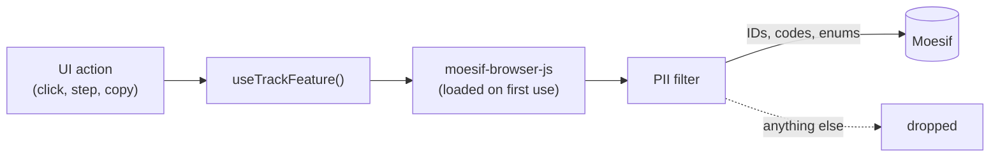

# Feature Usage Tracking for the API Control Plane: Summary

|        |                                                                             |
| ------ | --------------------------------------------------------------------------- |
| Status | UI actions implemented; endpoint features defined (emitted by Platform API) |
| Date   | 2026-11-10                                                                  |
| Branch | `feature-usage-track`                                                       |
| Scope  | `portals/api-control-plane` (the console); API Portal later                 |

This document records what was built for API Platform feature usage tracking,
the decisions behind it, the taxonomy, and what the pull request contains. It
notes the solution taken at each step, not the options that were weighed.

---

## 1. Goal

Track which API Platform features people use, from the console, and send that
usage to Moesif, aligned with the WSO2 feature-taxonomy template
(`<product>.<category>.<feature-action>` codes, event categories, dimensions).
All WSO2 products publish to one WSO2 Moesif account, with a dashboard per
product. API Platform runs both on-prem and in WSO2 Cloud; usage is collected
from WSO2 Cloud only.

Two kinds of usage go into the taxonomy:

- **UI actions:** what a user does in the console (a click, a wizard step, a
  copy).
- **Endpoint invocations:** Platform API calls, reported by Platform API
  itself.

---

## 2. Decisions, in order

| #   | Decision                                                                                                                                                                                                                                                                |
| --- | ----------------------------------------------------------------------------------------------------------------------------------------------------------------------------------------------------------------------------------------------------------------------- |
| 1   | Track from the browser with `moesif-browser-js`, as the Bijira console does, using the publishable key (Collector Application Id) of the WSO2 Moesif application. No Moesif Events Proxy, no backend endpoint, no on-prem database in the first cut.                    |
| 2   | Off unless a deployment enables it: a runtime-config flag plus the key. On-prem leaves both unset and never downloads the SDK.                                                                                                                                          |
| 3   | The tracking path must not depend on Platform API, so the API Portal (which can run without it) can reuse it later.                                                                                                                                                     |
| 4   | Send IDs, codes and enums only: no names, emails, org/project/API handles, typed values, query strings or IPs in the payload.                                                                                                                                           |
| 5   | The SDK always sends the full page URL, which carries handles. Every SDK request passes one PII filter that rebuilds it from an allowlist (URL reduced to its route template). If the filter can't be installed, nothing is sent.                                       |
| 6   | The "feature used" event for API creation fires on the Create click, not on server success.                                                                                                                                                                             |
| 7   | The user ID is the token's `sub`; the company ID is the organization UUID. Both are sent only if they are UUIDs.                                                                                                                                                        |
| 8   | One feature per UI action, as the API creation wizard does (open → type → method → create). A dimension only describes a variant of the same action (REST or GraphQL, gateway type).                                                                                    |
| 9   | Codes follow `<product-id>.<category-id>.<feature-action>`, feature first (`apip.manage-apis.rest-api-create`).                                                                                                                                                         |
| 10  | Policy capabilities stay as their own UI features: on **Save changes**, one event per newly attached policy, under its capability. Policy names are an enum of the WSO2 policies bundled with the gateway; a custom policy's name is customer text and is never sent.   |
| 11  | Save Draft on a portal publication is one event per click, with `yes`/`no` flags for the parts it saved.                                                                                                                                                                |
| 12  | Endpoint invocations are in the taxonomy too, emitted by Platform API itself (the console isn't its only caller) in a separate pull request. Reads that fire on page load are excluded. Dimensions come only from the request.                                          |
| 13  | Endpoint events are reported the way agent-manager's `growthanalytics.Track` does it: built from the request, reported once per call when the response returns, with `outcome` from the status.                                                                         |
| 14  | For endpoint tracking, a policy save is just the `api-update` endpoint event; the capability detail lives in the UI features.                                                                                                                                           |
| 15  | Tests must never produce usage data.                                                                                                                                                                                                                                    |
| 16  | UI actions and endpoint features are both in the taxonomy: the UI shows how far users get, the endpoint whether the call worked. A UI action that triggers a tracked endpoint ends in `-click`; the endpoint feature has the bare name and is reported by Platform API. |

---

## 3. Design

### 3.1 UI actions (implemented)

- **Registry:** `src/featureUsage/taxonomy.ts` lists every code the console can
  emit, with its name, category, tier, event category and enum dimensions. A
  call with an unknown code or an out-of-enum value doesn't compile, and the
  filter drops it at runtime.
- **Hook:** `useTrackFeature()` attaches the signed-in user (`sub`) and
  organization ID. It never throws and does nothing when tracking is off.
- **SDK:** `moesif-browser-js` 1.10.2, pinned, imported lazily on the first
  tracked action. Batching every 5 s or 20 actions; referrer, UTM and `gclid`
  capture off; API-call capture never started.
- **PII filter:** wraps the SDK's internal `_executeRequest`, the one function
  every send path ends in, and rebuilds each payload from an allowlist: the URL
  becomes its route template (from `src/routes/paths.ts`), IDs survive only as
  UUIDs, metadata is rebuilt from the registry, and every other Moesif route is
  dropped. A contract test runs the real SDK to prove it.
- **When a UI action fires:** on the click that commits it, after client-side
  validation, once per click. Cancel, typing, navigation, search and view
  toggles report nothing.

### 3.2 Endpoint invocations (emitted by Platform API)

The console is not the only caller of Platform API (the CLI and other clients
call it too), so endpoint invocations are reported by Platform API itself, in a
separate pull request, not by the console. This pull request only defines them
in the taxonomy (§4.2): one feature per tracked endpoint, with dimensions taken
from the request alone, reported when the response is written with `outcome`
from the status, as agent-manager's `growthanalytics.Track` middleware does.

### 3.3 Configuration

| Where               | Setting                                                                                                                                                                                                                               |
| ------------------- | ------------------------------------------------------------------------------------------------------------------------------------------------------------------------------------------------------------------------------------- |
| WSO2 Cloud (no BFF) | `featureUsageTrackingEnabled: true` and `moesifPublishableKey` in `api-platform.env.config.js`; add `https://api.moesif.net` to any `connect-src` CSP                                                                                 |
| BFF-served          | `[api_control_plane.feature_usage]` `enabled` and `moesif_publishable_key` (env `APIP_ACP_FEATURE_USAGE_ENABLED`, `APIP_ACP_FEATURE_USAGE_MOESIF_PUBLISHABLE_KEY`); off by default; the BFF refuses to start if enabled without a key |

Setup steps, verification and dashboards are in `src/featureUsage/README.md`.

---

## 4. Taxonomy

The product taxonomy (`api-platform-taxonomy.yaml`, kept outside this
repository) was updated to the console's verified UI. `taxonomy.ts` matches it
for every code the console emits. Features the console has no UI for (API
Portal, CLI, gateway-only) are unchanged.

### 4.1 UI action features

**UI actions and endpoint features.** A UI action that triggers a Platform API
call ends in `-click` (`api-delete-click`). The endpoint it calls is a feature
of its own, without the suffix (`api-delete`), reported by Platform API with
request-only dimensions and an `outcome`. The UI actions show how far users get
and where they drop off; the endpoint features show whether the call worked.

`?` marks an optional dimension.

| Area         | Code (`apip.` + …)                                                                                               | Fires on                                              | Dimensions                                                                   |
| ------------ | ---------------------------------------------------------------------------------------------------------------- | ----------------------------------------------------- | ---------------------------------------------------------------------------- |
| API creation | `manage-apis.api-creation-wizard-open`                                                                           | wizard opens                                          | `entry_point`                                                                |
|              | `manage-apis.api-creation-wizard-api-type-select`                                                                | Continue on the type step                             | `api_type`                                                                   |
|              | `manage-apis.api-creation-wizard-creation-method-select`                                                         | Continue on the definition step                       | `api_type`, `creation_method`                                                |
|              | `manage-apis.rest-api-create-click` / `graphql-api-create-click`                                                 | Create                                                | `creation_method`, `contract_source`?                                        |
| APIs         | `manage-apis.api-update-click`                                                                                   | Save on the edit page                                 | `api_type`                                                                   |
|              | `manage-apis.api-endpoint-update-click`                                                                          | Save in the endpoint drawer                           | `api_type`                                                                   |
|              | `manage-apis.api-definition-update-click`                                                                        | "Update API" confirm (definition)                     | —                                                                            |
|              | `manage-apis.api-delete-click`                                                                                   | delete confirm                                        | `api_type`                                                                   |
|              | `manage-apis.api-thumbnail-upload-click` / `api-thumbnail-remove-click`                                          | upload / remove confirm                               | `api_type`?                                                                  |
|              | `manage-apis.api-document-create-click` / `-update-click` / `-delete-click`                                      | Create, Save, delete confirm                          | `api_type`?, `document_type`?                                                |
| Test         | `manage-apis.test-console-execute`                                                                               | Execute (REST) / run (GraphQL), after the response    | `api_type`, `call_mode`?, `outcome`                                          |
|              | `manage-apis.test-console-curl-copy`                                                                             | Copy command (cURL view)                              | `api_type`                                                                   |
| Keys         | `security.api-key-create-click`                                                                                  | Create key                                            | `artifact_kind`                                                              |
|              | `security.test-api-key-generate-click`                                                                           | Get Test API Key / Issue a new key                    | `artifact_kind`                                                              |
|              | `security.api-key-revoke-click`                                                                                  | revoke confirm                                        | `artifact_kind`                                                              |
| Policies     | `policies.<capability>-attach` (10 codes)                                                                        | Save changes, once per newly attached policy          | `artifact_kind`?, `policy_scope`?, `policy_name`                             |
|              | `policies.policy-hub-browse`                                                                                     | Policy Hub catalogue shown                            | `artifact_kind`?                                                             |
| Deploy       | `lifecycle.api-deploy-click`                                                                                     | Deploy                                                | `artifact_kind`, `gateway_type`, `gateway_hosting`?                          |
|              | `lifecycle.deployment-undeploy-click` / `-redeploy-click` / `-restore-click` / `-delete-click`                   | Stop, Redeploy, Restore, delete                       | `artifact_kind`                                                              |
|              | `lifecycle.deployment-history-view`                                                                              | View More                                             | `artifact_kind`?                                                             |
| Publish      | `lifecycle.api-publish-click`                                                                                    | Publish / Republish, one-click Publish                | `api_type`                                                                   |
|              | `lifecycle.api-unpublish-click` / `api-deprecate-click`                                                          | unpublish / deprecate confirm                         | `api_type`                                                                   |
|              | `lifecycle.publication-draft-save-click`                                                                         | Save Draft, once per click                            | `api_type`?, `definition_saved`, `thumbnail_changed`, `landing_page_changed` |
|              | `lifecycle.api-portal-open`                                                                                      | View in Portal                                        | `api_type`?                                                                  |
| Gateways     | `gateway.gateway-register-click`                                                                                 | Provision gateway                                     | `gateway_type`, `gateway_hosting`?                                           |
|              | `gateway.gateway-update-click`                                                                                   | Save (name, description)                              | `gateway_type`?                                                              |
|              | `gateway.gateway-token-regenerate-click`                                                                         | Generate new token confirm                            | —                                                                            |
|              | `gateway.gateway-setup-command-copy`                                                                             | any copy button in the setup steps                    | `install_method`, `setup_step`                                               |
|              | `policies.gateway-policies-view`                                                                                 | Policies tab, first open per visit                    | —                                                                            |
| Organization | `admin.project-create-click` / `project-delete-click`                                                            | Create; delete confirm                                | —                                                                            |
|              | `security.service-account-create-click` / `-update-click` / `-enable-click` / `-disable-click` / `-delete-click` | create, edit, enable, disable confirm, delete confirm | —                                                                            |
|              | `security.service-account-secret-regenerate-click`                                                               | regenerate confirm                                    | —                                                                            |
|              | `security.service-account-test-token-get-click`                                                                  | Get token                                             | —                                                                            |
|              | `monetization.meter-create-click` / `-update-click` / `-delete-click`                                            | Add, Save, delete confirm                             | —                                                                            |
|              | `monetization.subscription-plan-create-click` / `-update-click` / `-delete-click`                                | Add, Save, delete confirm                             | —                                                                            |
|              | `monetization.subscription-plan-status-change-click`                                                             | status switch                                         | `status`                                                                     |

Policy capabilities (`<capability>-attach`): `client-authentication`,
`backend-authentication`, `access-control`, `rate-limiting`, `traffic-routing`,
`transformation`, `content-validation`, `cors`, `interception`,
`analytics-filtering`.

### 4.2 Endpoint invocations to track

Operations the console calls that change something, with the dimensions their
request carries. Platform API reports them for every caller, not only the
console; each also carries `outcome`. In the taxonomy these features have
`platforms: ["api"]`, and their console counterparts are the `-click`
features in §4.1.

| Code (`apip.` + …)                                                               | Operation(s)                                                  | Request dimensions                                |
| -------------------------------------------------------------------------------- | ------------------------------------------------------------- | ------------------------------------------------- |
| `manage-apis.rest-api-create`                                                    | `ImportOpenAPI`                                               | — (scratch and contract send the same request)    |
| `manage-apis.graphql-api-create`                                                 | `CreateGraphQLAPI`                                            | `schema_source` (body)                            |
| `manage-apis.api-update`                                                         | `UpdateRESTAPI`, `UpdateGraphQLAPI` (includes policy saves)   | `api_type` (path)                                 |
| `manage-apis.api-definition-update`                                              | `UpdateRESTAPISpec`                                           | —                                                 |
| `manage-apis.api-delete`                                                         | `DeleteRESTAPI`, `DeleteGraphQLAPI`                           | `api_type`                                        |
| `manage-apis.api-contract-validate`                                              | `ValidateOpenAPISpec`, `ValidateGraphQLSchema`                | `contract_type`, `contract_source` (body)         |
| `manage-apis.api-thumbnail-upload` / `-remove`                                   | `UpsertAPIThumbnail`, `DeleteAPIThumbnail`                    | `api_type`                                        |
| `manage-apis.api-document-create` / `-update` / `-delete`                        | `CreateAPIDocument`, `UpdateAPIDocument`, `DeleteAPIDocument` | `api_type`; `document_type` (body, create/update) |
| `manage-apis.api-test-invoke`                                                    | `InvokeRESTAPIOnGateway` (test console, proxy mode)           | —                                                 |
| `security.api-key-create`                                                        | `CreateAPIKey`, `CreateGraphQLAPIKey`                         | `artifact_kind`                                   |
| `security.api-key-revoke`                                                        | `RevokeAPIKey`, `RevokeGraphQLAPIKey`                         | `artifact_kind`                                   |
| `security.service-account-create` / `-update` / `-delete` / `-secret-regenerate` | the service-account operations                                | `status` (body, update)                           |
| `security.service-account-token-issue`                                           | `issueServiceAccountToken`                                    | `grant_type` (body)                               |
| `gateway.gateway-register`                                                       | `CreateGateway`                                               | `gateway_type`, `gateway_hosting` (body)          |
| `gateway.gateway-update`                                                         | `UpdateGateway`                                               | `gateway_type` (body)                             |
| `gateway.gateway-token-regenerate`                                               | `rotateGatewayToken`                                          | —                                                 |
| `lifecycle.api-deploy`                                                           | `DeployAPI`, `DeployGraphQLAPI`                               | `artifact_kind`                                   |
| `lifecycle.deployment-undeploy` / `-restore` / `-delete`                         | the deployment operations, REST and GraphQL                   | `artifact_kind`                                   |
| `lifecycle.api-publish` / `api-unpublish` / `api-deprecate`                      | the portal publish operations                                 | `api_type`                                        |
| `lifecycle.publication-draft-save`                                               | the four draft-save operations                                | `api_type`, `draft_part` (path)                   |
| `monetization.subscription-plan-create` / `-update` / `-delete`                  | the plan operations                                           | `status` (body, update)                           |
| `monetization.meter-create` / `-update` / `-delete`                              | the meter operations                                          | —                                                 |
| `admin.project-create` / `-delete`                                               | `CreateProject`, `DeleteProject`                              | —                                                 |

Every endpoint event also carries `outcome` (`success` or `failure`, from the
response status).

### 4.3 Endpoints excluded

**Reads (every `GET` in the client; the console calls them as pages and tabs load, and some aren't called at all):** `ListAPIDocuments`,
`GetAPIDocument`, `listUserAPIKeys`, `ListApiPortals`, `listApiPublications`,
`getApiPublicationDraft`, `getApiPublication`, `ListApplications`,
`GetApplication`, `ListApplicationAPIKeys`, `ListApplicationAssociations`,
`ListApplicationAssociationAPIKeys`, `ListGatewayCustomPolicies`,
`GetGatewayCustomPolicy`, `ListGateways`, `GetGateway`, `listGatewayTokens`,
`GetGatewayManifest`, `GetGraphQLAPIGateways`, `GetGraphQLAPIDeployments`,
`GetGraphQLAPIDeployment`, `ListGraphQLAPIs`, `GetGraphQLAPI`,
`GetGraphQLAPISDL`, `ListMeters`, `GetMeter`, `ListOrganizations`,
`GetOrganization`, `ListProjects`, `GetProject`, `GetRESTAPIGateways`,
`GetDeployments`, `GetDeployment`, `ListRESTAPIs`, `GetRESTAPI`,
`GetRESTAPISpec`, `listSecrets`, `getSecret`, `listServiceAccounts`,
`getServiceAccount`, `listRoles`, `ListSubscriptionPlans`,
`GetSubscriptionPlan`, `GetSubscriptionPlanPricing`, `ListSubscriptions`,
`GetSubscription`, plus the Policy Hub catalogue reads.

**Calls made without a user action:** the test API key the test page mints on
load (`CreateAPIKey` / `CreateGraphQLAPIKey` from `useTestApiKey`). The same
operation is tracked when a user creates a key, so this one call opts out.

**Operations the console never calls** (client code exists, no UI uses it):
`CreateRESTAPI`, `AddGatewaysToAPI`, `RegisterOrganization`, `UpdateAPIKey`,
`UpdateGraphQLAPIKey`, `UpdateProject`, `DeleteGateway`, `revokeGatewayToken`,
`SyncCustomPolicy`, `DeleteGatewayCustomPolicy`, the application operations,
the secret operations and the subscription operations.

---

## 5. What the pull request contains

### 5.1 Code

| Area               | Files                                                                                                                                                                                                                                                               |
| ------------------ | ------------------------------------------------------------------------------------------------------------------------------------------------------------------------------------------------------------------------------------------------------------------- |
| Tracking module    | `src/featureUsage/`: `taxonomy.ts` (registry), `useTrackFeature.ts` (hook), `moesif.ts` (lazy SDK, identify, track), `piiFilter.ts` (allowlist), `policies.ts` (policy name → capability), `moesif-browser-js.d.ts`, `README.md`                                    |
| Configuration      | `src/config/runtime.ts`; BFF `internal/config` (`[feature_usage]`, runtime-config output, startup validation); `configs/config.toml`                                                                                                                                |
| User ID            | `src/contexts/auth` and BFF `internal/session`: the session user carries `id` (`sub`); shared fixture `testdata/claim-mapping-cases.json`                                                                                                                           |
| Instrumented pages | API creation wizard and its entry points; API list, edit, overview (endpoint, keys, thumbnail); definition, documents and policies; test console (REST, GraphQL, cURL); deploy; portal publishing; gateways; projects, service accounts, meters, subscription plans |
| Test helper        | `src/test/featureUsage.ts`                                                                                                                                                                                                                                          |
| Dependency         | `moesif-browser-js` 1.10.2 (Apache-2.0), pinned                                                                                                                                                                                                                     |

### 5.2 Tests, and why none of them sends usage data

| Kind              | Files                                                                                                                                                                                | What they check                                                                                                                                                             |
| ----------------- | ------------------------------------------------------------------------------------------------------------------------------------------------------------------------------------ | --------------------------------------------------------------------------------------------------------------------------------------------------------------------------- |
| Module unit tests | `featureUsage/taxonomy.test.ts`, `moesif.test.ts`, `piiFilter.test.ts`, `config/runtime.test.ts`, `apis/create/entryPoint.test.ts`, `develop/policies/newlyAttachedPolicies.test.ts` | code conventions, policy mapping, metadata building, the enable switch, identify, URL masking and the allowlist, runtime-config parsing, entry-point state, the policy diff |
| SDK contract test | `featureUsage/moesif.sdk.test.ts`                                                                                                                                                    | the real SDK behind the filter: what reaches the network has no handles, query strings or names                                                                             |
| Funnel test       | `apis/create/ApiCreationWizard.featureUsage.test.tsx`                                                                                                                                | the wizard's steps, in order, through a fake SDK                                                                                                                            |
| Call-site tests   | the other page tests listed in the PR (for example `apis/components/ApiThumbnailManager.test.tsx`)                                                                                   | that each control reports the right code and dimensions on commit, and nothing on Cancel                                                                                    |

No test sends anything to Moesif:

- **Off by default.** Tracking is off unless the runtime config enables it, and
  no test environment sets the flag or a real key.
- **Call-site tests.** They replace the tracking function itself with a mock
  (`vi.mock('@/featureUsage/moesif')`), so a tracked click only records a call
  in memory; the SDK is never loaded.
- **Module and funnel tests.** The tests that switch tracking on mock
  `moesif-browser-js` entirely.
- **The contract test.** It is the only one using the real SDK, with a fake key.
  Its requests are intercepted in-process by MSW.
- **MSW backstop.** The test server fails any request it doesn't expect
  (`onUnhandledRequest: 'error'`), so a request to the real Moesif would fail
  the test, not reach it.

### 5.3 Verification

- **Static checks:** typecheck clean; ESLint clean on the changed files.
- **Tests:** the console suite passes (2,916 tests); the one failure,
  `PortalPublishPage — while a publish runs`, also fails on the base commit.
- **BFF:** `go vet` and `go test ./...` pass.
- **Build and i18n:** the production build passes (the SDK is a separate 55 KB
  chunk); the i18n catalog is unchanged.

---

## 6. Known limitations and next steps

| Item                         | Note                                                                                                                                                                               |
| ---------------------------- | ---------------------------------------------------------------------------------------------------------------------------------------------------------------------------------- |
| Endpoint invocation tracking | Emitted by Platform API in a separate pull request; this one only defines the features (§4.2)                                                                                      |
| Pages WSO2 Cloud replaces    | The Gateways and Deploy pages are cloud-plugin pages in WSO2 Cloud; their tracking needs the plugins to report too                                                                 |
| Ad blockers                  | Block `api.moesif.net`; those users aren't counted                                                                                                                                 |
| No excluded-orgs list        | Internal and test orgs are counted; use a separate Moesif application outside production                                                                                           |
| IDs only                     | Moesif shows UUIDs, not names                                                                                                                                                      |
| `rest-api-create` dimensions | The YAML entry has none; under the endpoint rule (§4.2) the request carries none, so the console's UI event keeps scratch/contract on `api-creation-wizard-creation-method-select` |
| API Portal                   | To reuse the module                                                                                                                                                                |
