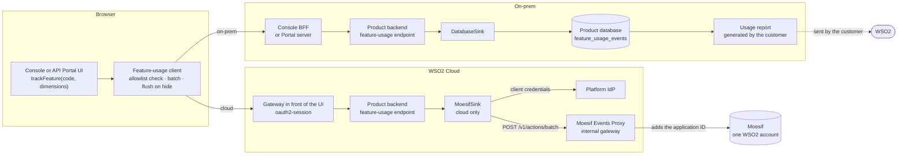
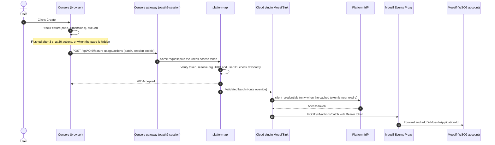
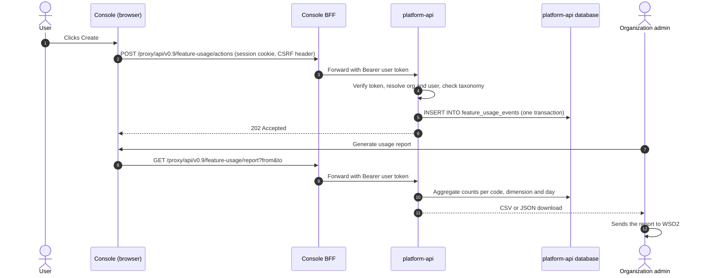
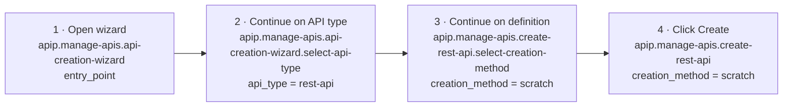

# Feature Usage Tracking for API Platform: Design

|        |                                                    |
| ------ | -------------------------------------------------- |
| Status | Draft for review                                   |
| Date   | 2026-11-09                                         |
| Scope  | API Control Plane (console) first, then API Portal |
| Branch | `feature-usage-track`                              |

## 1. Summary

The API Platform UIs report which features people use, as Moesif **actions**
named by their [feature-taxonomy](#appendix-a-taxonomy-additions) code. Every
UI step of a feature is one action, so a Moesif funnel can order the steps and
show where users stop.

- **WSO2 Cloud:** actions go to the single WSO2 Moesif account through the
  Moesif Events Proxy.
- **On-prem:** actions never go to Moesif. They are stored in the product's own
  database, and the customer generates a report and sends it to WSO2.

Both paths start in the browser and go through **one endpoint on the product's
own backend**. Only that backend's sink differs between the two deployments.

The browser side is implemented for the first feature, REST API creation from
scratch. The backend endpoint is proposed here.

## 2. Requirements and constraints

| #   | Requirement or constraint                                                                         | Source                                          |
| --- | ------------------------------------------------------------------------------------------------- | ----------------------------------------------- |
| R1  | Track feature usage from UI interactions, aligned to the WSO2 feature-taxonomy template           | Task                                            |
| R2  | One action per UI step, so Moesif funnels can group a feature's steps in order                    | Task                                            |
| R3  | Cloud data goes through the Moesif Events Proxy, in its `Action` format                           | Moesif proxy guide                              |
| R4  | All products publish to **one WSO2 Moesif account**, with a dashboard per product                 | Product decision                                |
| R5  | On-prem never sends to Moesif: product database plus customer-generated report                    | Product decision                                |
| R6  | Must also serve the API Portal, which can run without platform-api                                | Product decision                                |
| R7  | IDs, codes and enums only: no names, emails, handles, free text or IPs                            | Moesif proxy guide                              |
| C1  | The proxy is reachable only inside the cloud control-plane cluster and needs a Platform IdP token | Moesif proxy guide                              |
| C2  | In WSO2 Cloud the console has no BFF. It runs behind a gateway with the `oauth2-session` policy   | `portals/cloud-plugins/apip-cloud-ui/README.md` |
| C3  | The proxy checks a token's signature, issuer and expiry only. It forwards the body unchanged      | Moesif proxy guide                              |

## 3. Why a backend endpoint

The endpoint does more than choose between the proxy and the database. That is
the smallest of its jobs.

| Reason                        | Without the endpoint                                                                                                                                                                                                   |
| ----------------------------- | ---------------------------------------------------------------------------------------------------------------------------------------------------------------------------------------------------------------------- |
| **Reachability** (C1)         | A browser can't reach the proxy and holds no Platform IdP token. Something inside the cluster has to make the call.                                                                                                    |
| **Trustworthy identity** (C3) | If the browser writes `company_id` and `user_id`, any signed-in user can post actions under another organization's UUID (see [§10](#10-security-and-privacy)). The backend takes both from the verified token instead. |
| **Taxonomy enforcement** (R7) | Checks in the browser can be bypassed by anyone who skips our JavaScript. The backend's allowlist is the one that counts.                                                                                              |
| **On-prem storage** (R5)      | A browser can't write to a database. On-prem needs this endpoint regardless.                                                                                                                                           |
| **One browser code path**     | The same request works in cloud and on-prem. Only the backend's sink changes.                                                                                                                                          |

### Alternatives considered

| Option                                                                     | Verdict                                                                                                                                                                                                     |
| -------------------------------------------------------------------------- | ----------------------------------------------------------------------------------------------------------------------------------------------------------------------------------------------------------- |
| A. Browser → `api.moesif.net` with a Moesif Application ID, as Bijira does | Rejected. The key sits in the browser, so anyone can write events. It bypasses the proxy (R3). Ad blockers block it. Identity is spoofable.                                                                 |
| B. Browser → a gateway route in front of the proxy                         | Cloud only, so on-prem still needs an endpoint. Identity is spoofable unless a custom gateway policy rewrites the body. The route must also hide the proxy's `/v1/events`, `/v1/users` and `/v1/companies`. |
| C. Relay in the console BFF                                                | Rejected. Cloud has no BFF (C2), and the API Portal has none either.                                                                                                                                        |
| **D. Endpoint on each product's backend, with a sink per deployment**      | **Recommended.** It meets every requirement. The console's backend is platform-api, and the API Portal's is its own server, so R6 holds.                                                                    |

## 4. Architecture



"Product backend" is platform-api for the console and the API Portal's own
Express server for the portal. The gateway (cloud) and the BFF (on-prem) are
the routes every UI request already takes. They add the user's token from the
session, and nothing new is deployed in them.

## 5. Components

### 5.1 Browser: feature-usage client (implemented)

`portals/api-control-plane/src/featureUsage/`

| File                 | Role                                                                                                                                                                                                                                                         |
| -------------------- | ------------------------------------------------------------------------------------------------------------------------------------------------------------------------------------------------------------------------------------------------------------ |
| `taxonomy.ts`        | The closed allowlist: each taxonomy code with its name, category, tier, event category and enum dimensions. `trackFeature` calls are type-checked against it.                                                                                                |
| `client.ts`          | Framework-free, so the API Portal can reuse it. Drops unknown codes, undeclared dimensions and values outside an enum. Batches (20 actions or 3 s), flushes with `keepalive` when the page is hidden, keeps a bounded queue, never retries and never throws. |
| `useTrackFeature.ts` | React glue. Creates the client from runtime config and exposes `trackFeature(code, dimensions)`.                                                                                                                                                             |

The client sends no URL, referrer, IP or credentials of its own. The session
cookie is what lets the gateway or BFF attach the user's token.

### 5.2 Console backend: platform-api endpoint (proposed)

`POST /api/v0.9/feature-usage/actions`

| Piece    | Location                                                                                       |
| -------- | ---------------------------------------------------------------------------------------------- |
| Contract | `platform-api/resources/openapi.yaml`                                                          |
| Handler  | `platform-api/internal/handler/feature_usage.go`, with `RegisterRoutes(mux)` like `api_key.go` |
| Service  | `platform-api/internal/service/feature_usage.go`                                               |
| Sinks    | `DatabaseSink` in core. `MoesifSink` in the cloud plugin, see [§5.3](#53-sinks).               |
| Table    | Every dialect file in `platform-api/internal/database/`                                        |
| Config   | `[platform_api.feature_usage]` in `platform-api/config/config-template.toml`, off by default   |

On each request, the handler:

1. **Authenticates:** platform-api's auth middleware has already verified the JWT.
2. **Resolves identity:** the organization UUID comes from
   `middleware.GetOrganizationFromRequest` and the user ID from the verified
   token. Any identity in the body is ignored.
3. **Bounds the input:** `http.MaxBytesReader` (64 KB), at most 50 actions per
   batch, and a per-user rate limit.
4. **Validates:** codes and dimensions are checked against the server's copy of
   the taxonomy. Unknown entries are dropped and counted.
5. **Answers:** `202 Accepted` with `{accepted, dropped}`. Tracking never fails
   or slows down the user's request.
6. **Hands off:** the batch goes to the configured sink.

### 5.3 Sinks

| Sink           | Where                                                    | Behaviour                                                                                                                                                                                                                                                                            |
| -------------- | -------------------------------------------------------- | ------------------------------------------------------------------------------------------------------------------------------------------------------------------------------------------------------------------------------------------------------------------------------------ |
| `DatabaseSink` | Core platform-api, the on-prem default                   | Inserts one transaction per batch into `feature_usage_events`. Resends are deduplicated on `(organization_uuid, transaction_id)`.                                                                                                                                                    |
| `MoesifSink`   | **Platform-api cloud plugin** (`api-cloud`), recommended | Wraps the core route with `pdk.RouteOverride` and forwards to the proxy instead of the database. This keeps WSO2 Cloud specifics (Platform IdP credentials, the internal proxy URL) out of the open-source product, the way the cloud `/logs` endpoint already lives in that plugin. |

`MoesifSink` follows the proxy guide:

- **Token:** client credentials against the Platform IdP, cached until shortly
  before `expires_in`.
- **Request:** `POST {MOESIF_EVENTS_API_URL}/v1/actions/batch` with `Authorization: Bearer <token>`.
- **Responses:** on `401`, fetch a new token and retry once. On other `4xx`,
  log and drop. On `429`, `5xx` or a timeout, retry a few times with backoff.
- **Background:** sends run on a bounded worker pool and are dropped when the
  pool is full. Logs carry the action name and status, never the body or token.
- **Switch:** honours the `MOESIF_ENABLED` switch the guide asks for.

The alternative is to put `MoesifSink` in core platform-api behind
`sink = "moesif"`. That is simpler to ship, but it puts cloud-only code and
configuration in the on-prem product.

### 5.4 API Portal (later)

The same endpoint lives on the API Portal's Express server:

- **Routes:** `portals/api-portal/src/routes/`
- **Controller:** `src/controllers/`
- **DAO:** `src/dao/`
- **Table:** `portals/api-portal/database/schema.*.sql`
- **Cloud:** managed portals use a `MoesifSink` selected by configuration.

The portal loads the same `client.ts` and `taxonomy.ts`, moved to a shared
package and bundled for its page scripts. It reports the existing
`apip.developer-portal.*` codes.

## 6. Flows

### 6.1 Cloud: tracking one click



### 6.2 On-prem: tracking, then reporting



The report is what leaves the customer's site, so the data rules (R7) apply to
it: aggregated counts and distinct-user counts, no usernames. On-prem users
with file-based login have names such as `admin`, not UUIDs.

## 7. Data contracts

### 7.1 Browser → product backend

```http
POST /api/v0.9/feature-usage/actions
Content-Type: application/json

{
  "actions": [
    {
      "code": "apip.manage-apis.create-rest-api",
      "occurredAt": "2026-11-09T07:15:00Z",
      "transactionId": "5f0c8a9e-3b1d-4c6e-9a2f-1d7e4b8c0a11",
      "dimensions": { "creation_method": "scratch" }
    }
  ]
}
```

```http
202 Accepted

{ "accepted": 1, "dropped": 0 }
```

There are no identity fields: the backend owns identity. `transactionId` is a
random UUID made in the browser, so a resent batch can be deduplicated.

### 7.2 MoesifSink → Moesif Events Proxy

The proxy guide's `Action` schema, built by the backend:

```json
[
  {
    "action_name": "apip.manage-apis.create-rest-api",
    "request": { "time": "2026-11-09T07:15:00Z" },
    "company_id": "<organization UUID, from the token>",
    "user_id": "<Thunder user UUID, from the token>",
    "transaction_id": "5f0c8a9e-3b1d-4c6e-9a2f-1d7e4b8c0a11",
    "metadata": {
      "creation_method": "scratch",
      "action": "REST API Creation",
      "category": "manage-apis",
      "tier": "core",
      "event_category": "adoption",
      "initiating_product": "apip",
      "platform": "web"
    }
  }
]
```

The metadata keys after the feature's dimensions are the ones in the proxy
guide's example, plus `platform` (`tracking.platforms` in the template).

### 7.3 On-prem table

Illustrative only. The real definition goes through the `designing-db-schemas`
skill (rules R1–R10). A new table is an allowed additive change on a shipped
product (R0). Its guarded `CREATE TABLE IF NOT EXISTS` goes in every dialect
file, which also covers existing databases on upgrade.

```sql
-- PostgreSQL shown. SQLite and SQL Server use their own types per R3 and R8.
CREATE TABLE IF NOT EXISTS feature_usage_events (
    uuid              VARCHAR(40)  PRIMARY KEY,       -- generated by the server
    organization_uuid VARCHAR(40)  NOT NULL,          -- from the token, never the body
    user_id           VARCHAR(...),                   -- from the token; width per R3-VARCHAR-SIZES
    feature_code      VARCHAR(...) NOT NULL,          -- taxonomy code
    dimensions        BYTEA,                          -- JSON of allowlisted enum values (R3-LARGE-PAYLOAD)
    transaction_id    VARCHAR(40)  NOT NULL,
    occurred_at       TIMESTAMPTZ  NOT NULL,
    created_at        TIMESTAMPTZ  NOT NULL DEFAULT CURRENT_TIMESTAMP,
    FOREIGN KEY (organization_uuid) REFERENCES organizations(uuid) ON DELETE CASCADE,
    UNIQUE (organization_uuid, transaction_id)
);
CREATE INDEX IF NOT EXISTS idx_feature_usage_events_org_time
    ON feature_usage_events (organization_uuid, occurred_at);
```

The table grows with every click, so it needs a retention rule, such as
purging rows older than 13 months.

## 8. Moesif account and identity keys

- **One account.** Every product publishes to the single WSO2 Moesif account.
  The proxy adds that account's Application ID, so neither the browser nor the
  backend holds or sends one.
- **Dashboards per product.** API Platform actions carry
  `metadata.initiating_product = "apip"`, and their names start with `apip.`.
  The API Platform dashboard filters on either.
- **Same keys as every other publisher.** Because all products share one
  account, `company_id` and `user_id` must be the same values the other
  services send. Otherwise one organization becomes several Moesif companies.
  - `company_id` is the organization UUID: the Thunder `ouId` in WSO2 Cloud.
  - `user_id` is the Thunder user UUID: the token's `sub`.

  The backend must send these values, not platform-api's internal IDs (open
  questions 2 and 3).

## 9. The first feature: REST API creation from scratch

The wizard has three screens. **"Start from scratch" is the default tab**, so a
user can create from scratch without ever clicking it. Each step is recorded
when the user clicks Continue, along with the choice in effect.



| #   | Event category | Notes                                                                                                                                                                              |
| --- | -------------- | ---------------------------------------------------------------------------------------------------------------------------------------------------------------------------------- |
| 1   | discovery      | `entry_point`: `api-list`, `api-list-empty-state`, `org-home`, `project-quick-actions`, or `direct` for a typed URL or reload. It travels as router state, so the URL stays clean. |
| 2   | engagement     | Shared with GraphQL creation.                                                                                                                                                      |
| 3   | engagement     | REST-specific. GraphQL gets its own step (`scratch` or `schema`) later.                                                                                                            |
| 4   | adoption       | Fires on the Create click (a submission that passed form validation), so a create the server then rejects still counts. Retry on the progress screen does not count again.         |

To build the funnel in Moesif, use those four actions in order. Filter step 2
on `metadata.api_type = rest-api` and steps 3–4 on
`metadata.creation_method = scratch`. Group by user or by company. Counting
action 4 alone gives feature usage. The step actions have codes of their own,
so they never inflate it.

**Form fields are not tracked.** Name and identifier are prefilled, every edit
would be noise, and their values are customer text. Users who reach step 3 but
never step 4 are the form drop-off.

## 10. Security and privacy

- **Identity from the token only.** The backend ignores identity in the body,
  which closes the spoofing gap of a browser writing straight to the proxy
  (C3). In that gap, a signed-in user could post actions under any
  organization UUID they know.
- **Closed allowlist, enforced twice.** The browser filters for data quality
  and compile-time typing. The backend's check is the one that counts. There
  are no free-text dimensions.
- **Authorization.** platform-api denies any route without a declared scope, so
  this route needs either a scope that every role holds or an exempt-route
  entry (open question 1). The report endpoint needs an admin-only scope.
- **Hardening.**
  - Body and batch-size caps, plus a per-user rate limit.
  - A bounded worker pool that drops work when full, with timeouts and retries
    only as the guide prescribes.
  - No tokens or bodies in logs.
  - All per `.claude/rules/go-network-service-hardening.md`.
- **Off by default.** Nothing is recorded unless the deployment enables it.

## 11. Configuration

| Where                          | Setting                                                              | Purpose                                                                            |
| ------------------------------ | -------------------------------------------------------------------- | ---------------------------------------------------------------------------------- |
| Browser runtime config         | `featureUsageEnabled`                                                | Turns the browser tracker on. The endpoint path derives from `platformApiBaseUrl`. |
| platform-api                   | `[platform_api.feature_usage] enabled`                               | Accepts and processes UI actions. Off by default.                                  |
| platform-api                   | `retention_days`                                                     | On-prem retention of `feature_usage_events`.                                       |
| Cloud plugin (release binding) | `MOESIF_EVENTS_API_URL` = `${internal_gateway_url}/moesif-collector` | Proxy base URL, as the guide specifies                                             |
| Cloud plugin                   | `PLATFORM_IDP_TOKEN_URL`, client ID and secret (Vault)               | Token for the proxy                                                                |
| Cloud plugin                   | `MOESIF_ENABLED`                                                     | The guide's per-environment switch                                                 |

## 12. Implementation status and plan

| Phase | Scope                                                                                                         | Status                                           |
| ----- | ------------------------------------------------------------------------------------------------------------- | ------------------------------------------------ |
| 1     | Browser client and taxonomy registry, REST-from-scratch funnel, entry points, user ID on the session, tests   | **Done** on `feature-usage-track`, not committed |
| 2     | platform-api endpoint, plus `MoesifSink` in the cloud plugin. Switch the browser client to the §7.1 contract. | Proposed                                         |
| 3     | On-prem: `feature_usage_events` table, `DatabaseSink`, report endpoint and button                             | After the schema and report are planned          |
| 4     | API Portal: shared client package, portal endpoint, portal features                                           | Proposed                                         |
| 5     | More console features: GraphQL creation, contract import, deploy, publish, and so on                          | Proposed                                         |

Phase 2 changes for the implemented browser client: it currently builds full
Moesif actions, including identity, and posts them to a configurable
collector. It moves to posting §7.1 batches to the product endpoint. Building
the Moesif action, identity included, moves to the backend. The allowlist,
batching and flushing stay as they are.

## 13. Open questions

1. **Endpoint authorization:** a new scope granted to every role, or an exempt
   route (agent-manager chose an allowlisted route without a scope)?
2. **Organization ID:** does platform-api's organization UUID equal the Thunder
   `ouId` in WSO2 Cloud? `company_id` has to match the other publishers.
3. **User ID:** the plugin SDK exposes platform-api's internal user ID, while
   Moesif needs the Thunder user UUID. Is a small plugin SDK addition needed?
4. **Machine client:** which Platform IdP client should platform-api's cloud
   plugin use? Reuse an existing one, or request one from Cloud Platform
   Engineering.
5. **`MoesifSink` placement:** the cloud plugin (recommended), or core
   platform-api behind config?
6. **Taxonomy:**
   - Approve the codes in Appendix A, including the event-category change.
   - Register them in wso2cloud's
     `backend/core/pkg/taxonomy/wso2-cloud-features-taxonomy.yaml`.
   - Decide whether the TypeScript and Go registries are generated from the
     YAML or kept in step by a consistency test.
7. **On-prem report:**
   - Schema and retention.
   - Report format.
   - Exactly what leaves the customer's site.

## Appendix A: taxonomy changes

The console's features were checked against its pages (every button, link and
dialog that commits an action), and `api-platform-taxonomy.yaml` was updated to
match. `src/featureUsage/taxonomy.ts` is the console's copy: every code it can
emit, with only the enum values its UI can produce. Its names, event
categories, required flags and values were checked against the YAML; the YAML
is not in this repository, so a change to either must be copied to the other.

Codes are permanent once data exists, so these changes were made before any
data was collected.

Two rules shape every console feature:

- **One feature per UI action.** Each button, confirm or wizard step that
  commits something has its own code, as the API creation wizard does (open →
  type → method → create). A dimension only describes a variant of the same
  action, such as REST or GraphQL, or the gateway type. Features that bundled
  several actions under an `operation` or `part` dimension were split.
- **`<product-id>.<category-id>.<feature-action>`**, feature first, as the
  template's `apim.api-designer.openapi-import`. The second segment is the
  category id.

| Change                          | Before → after                                                                                                                                                                                                                                                                                                                                                                                                                                                                                                                                                                                                                                                                                                                                                                                                                                                                                                                            |
| ------------------------------- | ----------------------------------------------------------------------------------------------------------------------------------------------------------------------------------------------------------------------------------------------------------------------------------------------------------------------------------------------------------------------------------------------------------------------------------------------------------------------------------------------------------------------------------------------------------------------------------------------------------------------------------------------------------------------------------------------------------------------------------------------------------------------------------------------------------------------------------------------------------------------------------------------------------------------------------------- |
| API creation wizard (new)       | `api-creation-wizard-open`, `api-creation-wizard-api-type-select`, `api-creation-wizard-creation-method-select`                                                                                                                                                                                                                                                                                                                                                                                                                                                                                                                                                                                                                                                                                                                                                                                                                           |
| Renamed to feature-action       | `create-rest-api` → `rest-api-create`, `create-graphql-api` → `graphql-api-create`, `delete-api` → `api-delete`, `test-console` → `test-console-execute`, `register-gateway` → `gateway-register`, `deploy-api` → `api-deploy`, `view-deployment-history` → `deployment-history-view`, `publish-api` → `api-publish`, `open-api-portal` → `api-portal-open`, `browse-policies` → `policy-hub-browse`, `view-gateway-policies` → `gateway-policies-view`, policy capabilities → `<capability>-attach`                                                                                                                                                                                                                                                                                                                                                                                                                                      |
| Split per UI action             | `update-api` → `api-update`, `api-endpoint-update`, `api-definition-update`; `api-thumbnail` → `api-thumbnail-upload`, `-remove`; `api-documentation` → `api-document-create`, `-update`, `-delete`; `api-key-issuance` → `api-key-create`, `test-api-key-generate`; `api-key-management` → `api-key-revoke`; `service-accounts` → `service-account-create`, `-update`, `-enable`, `-disable`, `-delete`, `-secret-regenerate`, `-test-token-get`; `deploy-api` sub-features and later `manage-deployment` → `deployment-undeploy`, `-redeploy`, `-restore`, `-delete`; `publish-api` sub-features → `api-unpublish`, `api-deprecate`; `manage-gateway` → `gateway-update`; `gateway-token` → `gateway-token-regenerate`; `subscription-plan-management` → `subscription-plan-create`, `-update`, `-status-change`, `-delete`; `meter-management` → `meter-create`, `-update`, `-delete`; `manage-projects` → `project-create`, `-delete` |
| Save Draft                      | `publication-draft` (one event per part) → `publication-draft-save`, one event per click with `definition_saved`, `thumbnail_changed`, `landing_page_changed` (`yes`/`no`)                                                                                                                                                                                                                                                                                                                                                                                                                                                                                                                                                                                                                                                                                                                                                                |
| New console features            | `test-console-curl-copy`, `gateway-setup-command-copy`                                                                                                                                                                                                                                                                                                                                                                                                                                                                                                                                                                                                                                                                                                                                                                                                                                                                                    |
| Creation dimensions             | REST and GraphQL creation both carry `creation_method` (`scratch`/`contract`) and an optional `contract_source`; both are `adoption`                                                                                                                                                                                                                                                                                                                                                                                                                                                                                                                                                                                                                                                                                                                                                                                                      |
| Policy dimensions               | `policy_name` is an enum of the WSO2 policies bundled with the gateway (a custom policy's name is customer text); new optional `policy_scope` (`api`/`operation`)                                                                                                                                                                                                                                                                                                                                                                                                                                                                                                                                                                                                                                                                                                                                                                         |
| Extended enums                  | `gateway_type` + `event`                                                                                                                                                                                                                                                                                                                                                                                                                                                                                                                                                                                                                                                                                                                                                                                                                                                                                                                  |
| UI actions vs endpoint features | A UI action that triggers a tracked endpoint ends in `-click` (`api-delete-click`); the endpoint feature keeps the bare name (`api-delete`), with request-only dimensions plus `outcome`, and is reported by Platform API                                                                                                                                                                                                                                                                                                                                                                                                                                                                                                                                                                                                                                                                                                                 |

Taxonomy features the console has no UI for (for example gateway deletion,
token revocation, secrets, builds, contract validation as a separate step) are
unchanged; other surfaces (CLI, API, API Portal, cloud plugins) may emit them.

## Appendix B: references

- Moesif Events Proxy: Integration Guide (Cloud Platform Engineering, 2026-11-03)
- WSO2 Feature Taxonomy: Common Schema Definition v1.0.0
- Existing Bijira Taxonomy: source-derived event inventory (2026-11-04)
- agent-manager console telemetry: wso2/agent-manager PR #1932
- Implementation: `portals/api-control-plane/src/featureUsage/`
