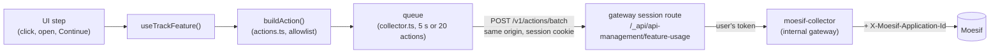

# Feature-usage tracking — api-control-plane

The console reports which features people use to Moesif, as **actions** named by
their [feature-taxonomy](#1-put-the-feature-in-the-taxonomy) code. Each UI step
of a feature is one action, so a Moesif funnel can line the steps up and show
where users drop off.

It is **off unless a deployment turns it on**. An on-prem install sends nothing,
and builds no actions.



The console uses no Moesif SDK. It builds each action itself from an allowlist,
in the shape Moesif's Collection API expects (the same shape agent-manager
sends), and posts batches to a same-origin gateway route. That route swaps the
session cookie for the user's token and forwards to the in-cluster Moesif
collector, which adds the environment's Application ID. The browser never talks
to Moesif and never holds an Application ID.

This is the first cut. The longer-term design (a backend endpoint, an on-prem
store) is in
[`spec/design/feature-usage-tracking.md`](../../spec/design/feature-usage-tracking.md).

- [Set it up on WSO2 Cloud](#set-it-up-on-wso2-cloud)
- [On-prem and BFF-served deployments](#on-prem-and-bff-served-deployments)
- [Configuration reference](#configuration-reference)
- [What is sent](#what-is-sent)
- [Add tracking to a feature](#add-tracking-to-a-feature)
- [Known limitations](#known-limitations)
- [Files](#files)

---

## Set it up on WSO2 Cloud

In WSO2 Cloud the console runs without the BFF, as static files behind the
control-plane gateway (`authMode: 'external'`). The gateway's
`oauth2-session-proxy` routes handle sign-in and every API call. The console reads
its settings from `window.__RUNTIME_CONFIG__` in `api-platform.env.config.js`,
which the `apip-console` release binding in `wso2cloud-deployment` mounts per
environment.

### 1. The Moesif Application ID: nothing to do in the console

Each environment (dev, stage, prod) has its own Moesif application. Its ID is
the secret `moesif-app-id-wso2-cloud-collector` in that environment's secret
store, set through Terraform in the environment's branch of
`wso2cloud-deployment`. Flux substitutes it as
`${moesif_application_id_wso2_cloud_collector}` into the `moesif-collector-api`
release binding, which sends it as `X-Moesif-Application-Id` on every request
it forwards to Moesif.

The `main` branch stays one template, and each environment's secret supplies its
own ID. No environment setting is needed, and the IDs are never committed to
git. Platform API's endpoint events use the same collector, so UI and endpoint
actions land in the same application.

### 2. Add the gateway session route

In `wso2cloud-deployment`, add a `RestApi` to
`controlplane/common/init/layer-3/gateway-bff/api-management/proxy-api-management-restapi.yaml`,
next to the billing, cloud and marketing-consent routes:

- **Context:** `${apip_console_proxy_context:=/_api/api-management}/feature-usage`,
  the same value as `featureUsageCollectorPath` below, so the two always match.
- **Upstream:** `${internal_gateway_url}/moesif-collector`.
- **Policy:** the same `oauth2-session-proxy` as the other api-management
  routes.
- **Operations:** `POST /v1/actions/batch` only.

The route needs a signed-in session, so nobody else can write to the Moesif
application. It allows only the one Moesif route the console uses.

### 3. Add two keys to the runtime config

In the `apip-console` release binding, add these to `api-platform.env.config.js`:

```js
window.__RUNTIME_CONFIG__ = {
  // …existing keys (authMode, platformApiBaseUrl, …)
  featureUsageTrackingEnabled: '${apip_console_feature_usage_enabled:=false}',
  featureUsageCollectorPath: '${apip_console_proxy_context:=/_api/api-management}/feature-usage',
};
```

Then set `apip_console_feature_usage_enabled: "true"` in an environment
branch's `developer-domain.yaml` to turn tracking on there.

Both keys are required, so with only one set, tracking stays off. The collector
path must be a plain same-origin path. A full URL, or a `//host` one, is
ignored, which turns tracking off rather than sending data elsewhere.

### 4. Check that it works

In the browser:

1. Sign in to the console, open DevTools → **Network** and filter on
   `feature-usage`.
2. Open the API creation wizard (**APIs → Create**).
3. Within 5 seconds of the first tracked step (or after 20 actions, or when you
   leave the page), the browser sends
   `POST /_api/api-management/feature-usage/v1/actions/batch`. Check it:
   - the request goes to the console's own origin, never `api.moesif.net`;
   - there's no `X-Moesif-Application-Id` header;
   - `action_name` is `apip.manage-apis.api-creation-wizard-open`;
   - `request.uri` is a route template such as
     `https://<console>/organizations/:orgHandle/projects/:projectHandler/apis/new`,
     with no org or project handle, no query string and no fragment;
   - `user_id` and `company_id` are UUIDs, and there's no name or email
     anywhere.

In Moesif:

4. Open the environment's Moesif application, open the live event log, show
   **Actions**, and filter on an action name that starts with `apip.` (or
   `metadata.initiating_product` = `apip`). The actions should arrive within a
   minute.

If nothing is sent at all, check both keys in DevTools
(`window.__RUNTIME_CONFIG__`). If the requests fail:

- **401:** the session cookie didn't reach the route. Check the route's `cookie`
  settings match the other api-management routes.
- **401 or 403 from the collector:** the collector didn't accept the user's
  token. Its route trusts the `PlatformIDPKeyManager` issuer.
- **404:** the route isn't deployed.

Tracking never shows an error to the user, so these are the only signs.

### 5. Build the API Platform dashboards

Every action carries the same metadata, so one filter selects API Platform:
`metadata.initiating_product = apip`. For the first feature:

| Moesif view              | Set-up                                                                                                                                                                                                                                 |
| ------------------------ | -------------------------------------------------------------------------------------------------------------------------------------------------------------------------------------------------------------------------------------- |
| REST API creation funnel | Funnel, in this order: `apip.manage-apis.api-creation-wizard-open` → `apip.manage-apis.api-creation-wizard-api-type-select` → `apip.manage-apis.api-creation-wizard-creation-method-select` → `apip.manage-apis.rest-api-create-click` |
| Where users start        | Segment `apip.manage-apis.api-creation-wizard-open` by `metadata.entry_point`                                                                                                                                                          |
| Scratch vs. contract     | Segment `apip.manage-apis.rest-api-create-click` by `metadata.creation_method`                                                                                                                                                         |
| Use across features      | Filter `metadata.event_category = engagement`, group by `action_name`                                                                                                                                                                  |

Whether the creation then worked is the endpoint feature `apip.manage-apis.rest-api-create`, which Platform API reports as an API event with an `outcome`.

Users and companies show up in Moesif as UUIDs: the Thunder user ID (`sub`) and
the organization ID (the `ouId` claim). The console never sends names.

### Turning it off

Set `apip_console_feature_usage_enabled` back to `"false"`. The next page load
sends nothing.

---

## On-prem and BFF-served deployments

Tracking is off. The BFF doesn't emit either key, and there's no collector route
for it to point at, so the console sends nothing.

---

## Configuration reference

| Runtime config key (`window.__RUNTIME_CONFIG__`) | Also read as                     | Build-time fallback                   | Default | Meaning                                                                            |
| ------------------------------------------------ | -------------------------------- | ------------------------------------- | ------- | ---------------------------------------------------------------------------------- |
| `featureUsageTrackingEnabled`                    | `FEATURE_USAGE_TRACKING_ENABLED` | `VITE_FEATURE_USAGE_TRACKING_ENABLED` | off     | `true` or `'true'` turns tracking on                                               |
| `featureUsageCollectorPath`                      | `FEATURE_USAGE_COLLECTOR_PATH`   | `VITE_FEATURE_USAGE_COLLECTOR_PATH`   | empty   | Same-origin path of the collector route, e.g. `/_api/api-management/feature-usage` |

Tracking is on only when the flag is true **and** the collector path is a valid
same-origin path. The build-time values apply only when the runtime config
doesn't set the key. A runtime `false` doesn't override a build-time `true`, so
don't set the `VITE_` values in a build that ships.

---

## What is sent

`actions.ts` builds every action from an allowlist. Nothing a page or the browser
adds is passed through; a field is sent only if it's in this table.

| Field                       | Value                                                                                                                                                                         |
| --------------------------- | ----------------------------------------------------------------------------------------------------------------------------------------------------------------------------- |
| `action_name`               | A code from `taxonomy.ts`. A code missing from the registry doesn't compile.                                                                                                  |
| `request.uri`               | The page URL reduced to its route template: org, project and API handles become `:orgHandle`, `:projectHandler` and `:apiHandler`. The query string and fragment are removed. |
| `request.time`              | When the step happened                                                                                                                                                        |
| `request.user_agent_string` | The browser's user agent, which Moesif uses for browser and OS breakdowns                                                                                                     |
| `user_id`                   | The IdP user ID (`sub`), only if it is a UUID                                                                                                                                 |
| `company_id`                | The organization ID, only if it is a UUID                                                                                                                                     |
| `session_token`             | A UUID per browser tab session, kept in `sessionStorage`                                                                                                                      |
| `metadata`                  | The feature's declared dimensions, plus `action`, `category`, `tier`, `event_category`, `initiating_product: apip` and `platform: web`                                        |

The browser **never sends** names, emails, org, project or API handles, anything
the user typed, query strings, fragments, the referrer, or UTM or `gclid`
campaign data. It sends to one Moesif route, `/v1/actions/batch`; there are no
user or company updates and no API-call capture.

---

## Add tracking to a feature

Instrumenting a feature takes four steps. `apis/create/ApiCreationWizard.tsx` is
the reference implementation.

### 1. Put the feature in the taxonomy

Features are defined in the API Platform feature taxonomy (the WSO2
feature-taxonomy schema v1) before the console can emit them. Agree on the entry
with the taxonomy owners first. Its rules:

- **`code`** is `<product>.<category>.<feature-action>`, feature first, e.g.
  `apip.manage-apis.rest-api-create`. The second segment is the category id.
  It is sent verbatim as the Moesif action name.
- **One code per UI action.** Each button, confirm or step that commits
  something is its own feature: `api-thumbnail-upload` and
  `api-thumbnail-remove`, not one code with an `operation` dimension. A
  dimension only describes a variant of the same action (REST or GraphQL, the
  gateway type). Each step of a flow is its own code too, so a Moesif funnel can
  order them (`api-creation-wizard-open` → `…-api-type-select` → …).
- **`event_category`** says what the step means:

  | Value         | Use it for                                                                | Example                         |
  | ------------- | ------------------------------------------------------------------------- | ------------------------------- |
  | `discovery`   | The user found or opened the feature                                      | Wizard opened                   |
  | `engagement`  | A step inside the feature, or its commit click                            | API type chosen, Create clicked |
  | `adoption`    | The feature's work was done (endpoint features, reported by Platform API) | API created                     |
  | `abandonment` | The user explicitly backed out                                            | Wizard cancelled                |
  | `lifecycle`   | A later change to something the feature made                              | API deleted                     |

- **Dimensions** are enums. Give each value a stable, lower-case, hyphenated
  name (`rest-api`, `api-list-empty-state`).

**Codes and enum values are permanent.** Moesif funnels and dashboards are built
on them. Renaming one splits its history in two, so add a new value instead of
renaming an old one.

### 2. Register it in `taxonomy.ts`

Copy the entry into `API_PLATFORM_FEATURES`:

```ts
'apip.manage-apis.api-delete': {
  name: 'API Deletion',            // taxonomy `name` → metadata.action
  category: 'manage-apis',         // taxonomy `category`
  tier: 'core',
  eventCategory: 'lifecycle',
  // required(): every emission carries it; optional(): sent only when it applies.
  dimensions: { api_type: required(['rest-api', 'graphql-api']) },
},
```

A feature with no required dimension can be called as `trackFeature(code)`.

A code missing from this registry can't be tracked: the call doesn't compile.

### 3. Call `useTrackFeature()` at the right moment

```tsx
import { useTrackFeature } from '@/featureUsage';

const trackFeature = useTrackFeature();

<Button
  onClick={() => {
    trackFeature('apip.manage-apis.api-delete', { api_type: 'rest-api' });
    confirmDelete();
  }}
/>;
```

The hook attributes the action to the signed-in user and organization, so call
sites never pass them. `trackFeature` returns at once, never throws, and does
nothing when tracking is off, so it is safe in any event handler.

When to fire:

| Step                  | Fire                                                                                            | Pattern                                                                                                                                         |
| --------------------- | ----------------------------------------------------------------------------------------------- | ----------------------------------------------------------------------------------------------------------------------------------------------- |
| Discovery (open)      | Once, when the page or dialog opens                                                             | A `useEffect` with a `useRef` guard, because effects re-run in StrictMode and when their dependencies change (see `openReported` in the wizard) |
| Engagement (a choice) | When the user moves past the step, with what they chose, including a default they never changed | The wizard's `continueFromSource`. "Start from scratch" is the default tab, so most users never click it.                                       |
| Commit (the click)    | On the click that commits the work, before the request                                          | `onGeneralFormSumit`. It counts intent: a server rejection still counts, and a retry is not a new use.                                          |

Don't fire in render, in a query, or in a mutation's `onSuccess`. Don't call
`trackFeatureUsage` from `collector.ts` directly; the hook is the only entry point
for UI code.

**If several places open the feature,** add an `entry_point` dimension. Pass the
value in router state, not the URL, and fall back to `direct` for a typed URL or
a reload. `apis/create/entryPoint.ts` does this for the wizard, and the pages
that link to it call `navigate(routes.newApi(…), apiCreationEntry('api-list'))`.

**Dimensions are enums only, by design.** `FeatureDimensions<C>` rejects any
other value at compile time, and `featureMetadata` drops values outside the
enum at runtime. So an API name, a URL or a typed value can't reach Moesif. If a feature
genuinely needs another kind of value, check it against the data rules first,
then change `FeatureSpec` and `featureMetadata` together.

### 4. Testing

The console's unit tests cover the tracking module itself (`src/featureUsage`:
the registry, the action builder and the batching client). Page unit tests don't assert tracking: which events a page reports
belongs in the browser-driven UI suite (`tests/framework/suites/ui`), which is
a separate effort.

### URLs are covered for you

`actions.ts` builds its route templates from `routes` in `src/routes/paths.ts`. A
page added the usual way (a `routes.*` builder, see the `apicp-ui` skill) is
masked with no change here. A URL that matches no template keeps only segments
known to be static and masks the rest as `:id`.

### Review checklist

- [ ] The code and its fields match an agreed taxonomy entry.
- [ ] Each action fires once, at the moment in the table above.
- [ ] Every dimension value comes from the UI's own enum, never from user input
      or server data.
- [ ] No code or enum value that already shipped was renamed.

---

## Known limitations

| Limitation                                                   | Effect                                                                 | Way out                                                         |
| ------------------------------------------------------------ | ---------------------------------------------------------------------- | --------------------------------------------------------------- |
| A batch that fails is dropped                                | Actions are lost when the collector is down or the session has expired | A persistent queue with retry                                   |
| No list of orgs to leave out                                 | Internal and test orgs in production are counted                       | Add the list (each environment already has its own application) |
| IDs only                                                     | Moesif dashboards show UUIDs, not user or org names                    | Server-side enrichment                                          |
| Identity is sent on the first tracked action, not at sign-in | A user who never reaches a tracked step never appears in Moesif        | Intended                                                        |

---

## What the console tracks

Every feature below fires on the click that commits it (after client-side
validation, before the request), once per click. Cancel, typing, navigation,
search and view toggles report nothing.

| Area         | Code (`apip.` + …)                                                                                               | Fires on                                              | Dimensions                                                                   |
| ------------ | ---------------------------------------------------------------------------------------------------------------- | ----------------------------------------------------- | ---------------------------------------------------------------------------- |
| API creation | `manage-apis.api-creation-wizard-open`                                                                           | wizard opens                                          | `entry_point`                                                                |
|              | `manage-apis.api-creation-wizard-api-type-select`                                                                | Continue on the type step                             | `api_type`                                                                   |
|              | `manage-apis.api-creation-wizard-creation-method-select`                                                         | Continue on the definition step                       | `api_type`, `creation_method`                                                |
|              | `manage-apis.rest-api-create-click` / `graphql-api-create-click`                                                 | Create                                                | `creation_method`, `contract_source`?                                        |
| APIs         | `manage-apis.api-update-click`                                                                                   | Save on the edit page                                 | `api_type`                                                                   |
|              | `manage-apis.api-endpoint-update-click`                                                                          | Save in the endpoint drawer                           | `api_type`                                                                   |
|              | `manage-apis.api-definition-update-click`                                                                        | "Update API" confirm (definition)                     | —                                                                            |
|              | `manage-apis.api-delete-click`                                                                                   | delete confirm                                        | `api_type`                                                                   |
|              | `manage-apis.api-thumbnail-upload-click` / `api-thumbnail-remove-click`                                          | upload / remove confirm                               | `api_type`?                                                                  |
|              | `manage-apis.api-document-create-click` / `-update-click` / `-delete-click`                                      | Create, Save, delete confirm                          | `api_type`?, `document_type`?                                                |
| Test         | `manage-apis.test-console-execute`                                                                               | Execute (REST) / run (GraphQL), after the response    | `api_type`, `call_mode`?, `outcome`                                          |
|              | `manage-apis.test-console-curl-copy`                                                                             | Copy command (cURL view)                              | `api_type`                                                                   |
| Keys         | `security.api-key-create-click`                                                                                  | Create key                                            | `artifact_kind`                                                              |
|              | `security.test-api-key-generate-click`                                                                           | Get Test API Key / Issue a new key                    | `artifact_kind`                                                              |
|              | `security.api-key-revoke-click`                                                                                  | revoke confirm                                        | `artifact_kind`                                                              |
| Policies     | `policies.<capability>-attach` (10 codes)                                                                        | Save changes, once per newly attached policy          | `artifact_kind`?, `policy_scope`?, `policy_name`                             |
|              | `policies.policy-hub-browse`                                                                                     | Policy Hub catalogue shown                            | `artifact_kind`?                                                             |
| Deploy       | `lifecycle.api-deploy-click`                                                                                     | Deploy                                                | `artifact_kind`, `gateway_type`, `gateway_hosting`?                          |
|              | `lifecycle.deployment-undeploy-click` / `-redeploy-click` / `-restore-click` / `-delete-click`                   | Stop, Redeploy, Restore, delete                       | `artifact_kind`                                                              |
|              | `lifecycle.deployment-history-view`                                                                              | View More                                             | `artifact_kind`?                                                             |
| Publish      | `lifecycle.api-publish-click`                                                                                    | Publish / Republish, one-click Publish                | `api_type`                                                                   |
|              | `lifecycle.api-unpublish-click` / `api-deprecate-click`                                                          | unpublish / deprecate confirm                         | `api_type`                                                                   |
|              | `lifecycle.publication-draft-save-click`                                                                         | Save Draft, once per click                            | `api_type`?, `definition_saved`, `thumbnail_changed`, `landing_page_changed` |
|              | `lifecycle.api-portal-open`                                                                                      | View in Portal                                        | `api_type`?                                                                  |
| Gateways     | `gateway.gateway-register-click`                                                                                 | Provision gateway                                     | `gateway_type`, `gateway_hosting`?                                           |
|              | `gateway.gateway-update-click`                                                                                   | Save (name, description)                              | `gateway_type`?                                                              |
|              | `gateway.gateway-token-regenerate-click`                                                                         | Generate new token confirm                            | —                                                                            |
|              | `gateway.gateway-setup-command-copy`                                                                             | any copy button in the setup steps                    | `install_method`, `setup_step`                                               |
|              | `policies.gateway-policies-view`                                                                                 | Policies tab, first open per visit                    | —                                                                            |
| Organization | `admin.project-create-click` / `project-delete-click`                                                            | Create; delete confirm                                | —                                                                            |
|              | `security.service-account-create-click` / `-update-click` / `-enable-click` / `-disable-click` / `-delete-click` | create, edit, enable, disable confirm, delete confirm | —                                                                            |
|              | `security.service-account-secret-regenerate-click`                                                               | regenerate confirm                                    | —                                                                            |
|              | `security.service-account-test-token-get-click`                                                                  | Get token                                             | —                                                                            |
|              | `monetization.meter-create-click` / `-update-click` / `-delete-click`                                            | Add, Save, delete confirm                             | —                                                                            |
|              | `monetization.subscription-plan-create-click` / `-update-click` / `-delete-click`                                | Add, Save, delete confirm                             | —                                                                            |
|              | `monetization.subscription-plan-status-change-click`                                                             | status switch                                         | `status`                                                                     |

**UI actions and endpoint features.** A UI action that triggers a Platform API
call ends in `-click` (`api-delete-click`). The endpoint it calls is a feature
of its own, without the suffix (`api-delete`), reported by Platform API with
request-only dimensions and an `outcome`. The UI actions show how far users get
and where they drop off; the endpoint features show whether the call worked.

`?` marks an optional dimension. `taxonomy.ts` lists every value.

**Policies.** The console doesn't know a policy's category, so
`trackPolicyAttachment` (`policies.ts`) maps the policy name to its capability
feature (`api-key-auth` → `apip.policies.client-authentication-attach`). Only the WSO2
policies bundled with the gateway are mapped; a custom, AI or MCP policy is not
reported, because its name could be the customer's own text.

**Not tracked, deliberately:** navigation (open an API, breadcrumbs, the
sidebar), search boxes, list/grid toggles, copy buttons for a URL or key,
documentation links, and the test key minted automatically on page load.

**Pages WSO2 Cloud replaces.** In the cloud build, the Gateways pages and both
Deploy pages are cloud-plugin pages (`page.gateways`, `page.apiDeploy`,
`page.graphqlApiDeploy`). The built-in pages above are tracked, but in WSO2
Cloud the gateway features, `gateway-policies-view`, `api-deploy`, the
`deployment-*` features and `deployment-history-view` only appear once the
cloud plugins report them too.

---

## Files

| File                    | Role                                                                         |
| ----------------------- | ---------------------------------------------------------------------------- |
| `index.ts`              | The public surface: `useTrackFeature`, `API_PLATFORM_FEATURES` and the types |
| `taxonomy.ts`           | The registry of trackable features, and `featureMetadata`                    |
| `policies.ts`           | `trackPolicyAttachment`: a policy name to its capability feature             |
| `useTrackFeature.ts`    | The hook UI code calls; attaches the user and organization                   |
| `actions.ts`            | Builds each action from the allowlist; masks page URLs to route templates    |
| `collector.ts`          | The enable switch, the queue, and the batched send to the collector route    |
| `*.test.ts`             | Unit tests                                                                   |
| `src/config/runtime.ts` | `featureUsageTrackingEnabled`, `featureUsageCollectorPath`                   |
