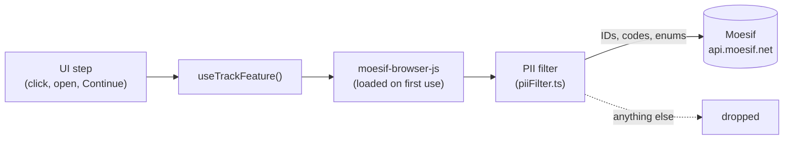

# Feature-usage tracking — api-control-plane

The console reports which features people use to Moesif, as **actions** named by
their [feature-taxonomy](#1-put-the-feature-in-the-taxonomy) code. Each UI step
of a feature is one action, so a Moesif funnel can line the steps up and show
where users drop off.

It is **off unless a deployment turns it on**. An on-prem install sends nothing,
and doesn't even download the Moesif SDK.



This is the first cut. It publishes straight from the browser with
`moesif-browser-js`. The longer-term design (a
backend endpoint, the Moesif Events Proxy, an on-prem store) is in
[`spec/design/feature-usage-tracking.md`](../../spec/design/feature-usage-tracking.md).

- [Set it up on WSO2 Cloud](#set-it-up-on-wso2-cloud)
- [Deployments served by the BFF (on-prem)](#deployments-served-by-the-bff-on-prem)
- [Configuration reference](#configuration-reference)
- [What is sent](#what-is-sent)
- [Add tracking to a feature](#add-tracking-to-a-feature)
- [Upgrade moesif-browser-js](#upgrade-moesif-browser-js)
- [Known limitations](#known-limitations)
- [Files](#files)

---

## Set it up on WSO2 Cloud

In WSO2 Cloud the console runs without the BFF, behind the API Platform gateway
(`authMode: 'external'`). It reads its settings from `window.__RUNTIME_CONFIG__`
in `api-platform.env.config.js`, which the cloud deployment serves per
environment. Turning tracking on is a change to that file, not a rebuild.

### 1. Get the Moesif publishable key

All WSO2 products publish to one WSO2 Moesif account, with a dashboard per
product. In that account, open the Moesif application that should receive API
Platform's actions, then go to the account menu → **API Keys** and copy the
**Collector Application Id**. It's a long token that starts with `eyJ`.

The Collector Application Id can only _write_ events. It is meant to be public:
it ends up in a script every visitor downloads. Never use a Management API key
here.

> **Use a separate key outside production.** The console has no list of orgs to
> leave out yet (see [Known limitations](#known-limitations)). Point dev and
> staging at a separate Moesif application, or leave tracking off there, so test
> traffic stays out of the production dashboards.

### 2. Add two keys to the runtime config

Add these to the environment's `api-platform.env.config.js`, next to the keys
already there:

```js
window.__RUNTIME_CONFIG__ = {
  // …existing keys (authMode, appBasePath, platformApiBaseUrl, …)
  featureUsageTrackingEnabled: true,
  moesifPublishableKey: '<Collector Application Id>',
};
```

Both are required. With only one of them set, tracking stays off.

### 3. Let the browser reach Moesif

The SDK posts to `https://api.moesif.net` from the user's browser. The SDK
itself is a chunk of the console's own bundle, served from the console's
origin.

- If the gateway or CDN in front of the console sets a `Content-Security-Policy`
  with `connect-src`, add `https://api.moesif.net` to it. Otherwise the browser
  blocks every request, and nothing shows up in Moesif. The BFF's own policy is
  `frame-ancestors 'self'` only, so it needs no change.
- The console needs no proxy, gateway route or backend change.

### 4. Check that it works

In the browser:

1. Sign in to the console, open DevTools → **Network** and filter on `moesif`.
2. Open the API creation wizard (**APIs → Create**).
3. On the first tracked step, the browser sends `POST /v1/companies` and
   `POST /v1/users`. It sends these once per user and organization, not on every
   page load.
4. Within 5 seconds (or after 20 actions), it sends `POST /v1/actions/batch`.
   Check its payload:
   - `action_name` is `apip.manage-apis.api-creation-wizard-open`;
   - `request.uri` is a route template such as
     `https://<console>/organizations/:orgHandle/projects/:projectHandler/apis/new`,
     with no org or project handle, no query string and no fragment;
   - `user_id` and `company_id` are UUIDs, and there's no name or email
     anywhere.

In Moesif:

5. Open the live event log, show **Actions**, and filter on an action name that
   starts with `apip.` (or `metadata.initiating_product` = `apip`). The actions
   should arrive within a minute.

If nothing is sent at all, check, in order:

- both keys are set (in DevTools, `window.__RUNTIME_CONFIG__`);
- the CSP lets the browser reach Moesif (look for a blocked request in the
  Console tab);
- an ad blocker isn't blocking `api.moesif.net`.

Tracking never shows an error to the user, so these are the only signs.

### 5. Build the API Platform dashboards

Every action carries the same metadata, so one filter selects API Platform:
`metadata.initiating_product = apip`. For the first feature:

| Moesif view              | Set-up                                                                                                                                                                                                                           |
| ------------------------ | -------------------------------------------------------------------------------------------------------------------------------------------------------------------------------------------------------------------------------- |
| REST API creation funnel | Funnel, in this order: `apip.manage-apis.api-creation-wizard-open` → `apip.manage-apis.api-creation-wizard-api-type-select` → `apip.manage-apis.api-creation-wizard-creation-method-select` → `apip.manage-apis.rest-api-create` |
| Where users start        | Segment `apip.manage-apis.api-creation-wizard-open` by `metadata.entry_point`                                                                                                                                                    |
| Scratch vs. contract     | Segment `apip.manage-apis.rest-api-create` by `metadata.creation_method`                                                                                                                                                         |
| Adoption across features | Filter `metadata.event_category = adoption`, group by `action_name`                                                                                                                                                              |

Users and companies show up in Moesif as UUIDs: the Thunder user ID (`sub`) and
the organization ID (the `ouId` claim). The console never sends names.

### Turning it off

Set `featureUsageTrackingEnabled: false`, or remove the key. The next page load
sends nothing and doesn't download the SDK.

---

## Deployments served by the BFF (on-prem)

When the BFF serves the console (`basic` or `oidc` auth), it generates the
runtime config itself. Tracking is off by default:

```toml
[api_control_plane.feature_usage]
enabled                = '{{ env "APIP_ACP_FEATURE_USAGE_ENABLED" "false" }}'
moesif_publishable_key = '{{ env "APIP_ACP_FEATURE_USAGE_MOESIF_PUBLISHABLE_KEY" "" }}'
```

- With `enabled = false` (the default), the BFF leaves both keys out of the
  runtime config.
- With `enabled = true` and no key, the BFF refuses to start:
  `[feature_usage] enabled = true requires moesif_publishable_key`.
- In basic mode the user's `sub` is their username, not a UUID. The console only
  sends UUIDs, so those users are tracked by organization only.

On-prem installs are not meant to send data to WSO2's Moesif. The setting exists
for BFF-served deployments that WSO2 runs itself.

---

## Configuration reference

| Runtime config key (`window.__RUNTIME_CONFIG__`) | Also read as                     | Build-time fallback                   | Default | Meaning                              |
| ------------------------------------------------ | -------------------------------- | ------------------------------------- | ------- | ------------------------------------ |
| `featureUsageTrackingEnabled`                    | `FEATURE_USAGE_TRACKING_ENABLED` | `VITE_FEATURE_USAGE_TRACKING_ENABLED` | off     | `true` or `'true'` turns tracking on |
| `moesifPublishableKey`                           | `MOESIF_PUBLISHABLE_KEY`         | `VITE_MOESIF_PUBLISHABLE_KEY`         | empty   | Moesif Collector Application Id      |

Tracking is on only when the flag is true **and** the key is not blank. The
build-time values apply only when the runtime config doesn't set the key. A
runtime `false` doesn't override a build-time `true`, so don't set the `VITE_`
values in a build that ships. For local development, put them in `.env.local`,
with the key of a _non-production_ Moesif application.

---

## What is sent

Every request the SDK makes goes through `piiFilter.ts` first. The filter
doesn't delete known-bad fields; it **rebuilds** each payload from an allowlist.
A field a future SDK version starts sending is therefore dropped by default.

| Field                                             | Value                                                                                                                                                                         |
| ------------------------------------------------- | ----------------------------------------------------------------------------------------------------------------------------------------------------------------------------- |
| `action_name`                                     | A code from `taxonomy.ts`. An action whose name isn't in the registry is dropped.                                                                                             |
| `request.uri`                                     | The page URL reduced to its route template: org, project and API handles become `:orgHandle`, `:projectHandler` and `:apiHandler`. The query string and fragment are removed. |
| `request.time`                                    | When the step happened                                                                                                                                                        |
| `request.user_agent_string`                       | The browser's user agent, which Moesif uses for browser and OS breakdowns                                                                                                     |
| `request.verb`                                    | Always `GET`                                                                                                                                                                  |
| `user_id`                                         | The IdP user ID (`sub`), only if it is a UUID                                                                                                                                 |
| `company_id`                                      | The organization ID, only if it is a UUID                                                                                                                                     |
| `anonymous_id`, `session_token`, `transaction_id` | UUIDs the SDK generates                                                                                                                                                       |
| `metadata`                                        | The feature's declared dimensions, plus `action`, `category`, `tier`, `event_category`, `initiating_product: apip` and `platform: web`                                        |

The browser **never sends** names, emails, org, project or API handles, anything
the user typed, query strings, fragments, the referrer, or UTM or `gclid`
campaign data. User and company updates carry their IDs only. Every other Moesif
route the SDK could call, including API-call capture (`/v1/events`), is
dropped.

If the filter can't be installed (for example, after an SDK upgrade that renamed
its internals), tracking turns itself off instead of sending unfiltered data.

---

## Add tracking to a feature

Instrumenting a feature takes four steps. `apis/create/ApiCreationWizard.tsx` is
the reference implementation.

### 1. Put the feature in the taxonomy

Features are defined in the API Platform feature taxonomy (the WSO2
feature-taxonomy schema v1) before the console can emit them. Agree on the entry
with the taxonomy owners first. Its rules:

- **`code`** is `<product>.<category>.<feature-action>`, feature first, e.g.
  `apip.manage-apis.rest-api-create`. The second segment is the category id.
  It is sent verbatim as the Moesif action name.
- **One code per UI action.** Each button, confirm or step that commits
  something is its own feature: `api-thumbnail-upload` and
  `api-thumbnail-remove`, not one code with an `operation` dimension. A
  dimension only describes a variant of the same action (REST or GraphQL, the
  gateway type). Each step of a flow is its own code too, so a Moesif funnel can
  order them (`api-creation-wizard-open` → `…-api-type-select` → …).
- **`event_category`** says what the step means:

  | Value         | Use it for                                   | Example          |
  | ------------- | -------------------------------------------- | ---------------- |
  | `discovery`   | The user found or opened the feature         | Wizard opened    |
  | `engagement`  | A step inside the feature                    | API type chosen  |
  | `adoption`    | The user did what the feature is for         | Create clicked   |
  | `abandonment` | The user explicitly backed out               | Wizard cancelled |
  | `lifecycle`   | A later change to something the feature made | API deleted      |

- **Dimensions** are enums. Give each value a stable, lower-case, hyphenated
  name (`rest-api`, `api-list-empty-state`).

**Codes and enum values are permanent.** Moesif funnels and dashboards are built
on them. Renaming one splits its history in two, so add a new value instead of
renaming an old one.

### 2. Register it in `taxonomy.ts`

Copy the entry into `API_PLATFORM_FEATURES`:

```ts
'apip.manage-apis.api-delete': {
  name: 'API Deletion',            // taxonomy `name` → metadata.action
  category: 'manage-apis',         // taxonomy `category`
  tier: 'core',
  eventCategory: 'lifecycle',
  // required(): every emission carries it; optional(): sent only when it applies.
  dimensions: { api_type: required(['rest-api', 'graphql-api']) },
},
```

A feature with no required dimension can be called as `trackFeature(code)`.

A code missing from this registry can't be tracked. The call doesn't compile,
and the filter would drop it anyway.

### 3. Call `useTrackFeature()` at the right moment

```tsx
import { useTrackFeature } from '@/featureUsage';

const trackFeature = useTrackFeature();

<Button
  onClick={() => {
    trackFeature('apip.manage-apis.api-delete', { api_type: 'rest-api' });
    confirmDelete();
  }}
/>;
```

The hook attributes the action to the signed-in user and organization, so call
sites never pass them. `trackFeature` returns at once, never throws, and does
nothing when tracking is off, so it is safe in any event handler.

When to fire:

| Step                  | Fire                                                                                            | Pattern                                                                                                                                         |
| --------------------- | ----------------------------------------------------------------------------------------------- | ----------------------------------------------------------------------------------------------------------------------------------------------- |
| Discovery (open)      | Once, when the page or dialog opens                                                             | A `useEffect` with a `useRef` guard, because effects re-run in StrictMode and when their dependencies change (see `openReported` in the wizard) |
| Engagement (a choice) | When the user moves past the step, with what they chose, including a default they never changed | The wizard's `continueFromSource`. "Start from scratch" is the default tab, so most users never click it.                                       |
| Adoption (the goal)   | On the click that commits the work, before the request                                          | `onGeneralFormSumit`. It counts intent: a server rejection still counts, and a retry is not a new use.                                          |

Don't fire in render, in a query, or in a mutation's `onSuccess`. Don't call
`trackFeatureUsage` from `moesif.ts` directly; the hook is the only entry point
for UI code.

**If several places open the feature,** add an `entry_point` dimension. Pass the
value in router state, not the URL, and fall back to `direct` for a typed URL or
a reload. `apis/create/entryPoint.ts` does this for the wizard, and the pages
that link to it call `navigate(routes.newApi(…), apiCreationEntry('api-list'))`.

**Dimensions are enums only, by design.** `FeatureDimensions<C>` rejects any
other value at compile time, and the filter drops values outside the enum at
runtime. So an API name, a URL or a typed value can't reach Moesif. If a feature
genuinely needs another kind of value, check it against the data rules first,
then change `FeatureSpec`, `featureMetadata` and the filter together.

### 4. Test it

For one control, use the helper in `src/test/featureUsage.ts`: add
`vi.mock('@/featureUsage/moesif');` to the test file, call
`resetTrackedFeatures()` in `beforeEach`, drive the real UI to the commit, and
assert `expect(trackedFeatures()).toEqual([[code, dimensions]])`. Also check
that Cancel reports nothing.

For a multi-step funnel through the SDK, copy
`ApiCreationWizard.featureUsage.test.tsx`:

- mock `moesif-browser-js` with a fake that **includes `_executeRequest`**.
  Without it, the PII filter can't install and tracking stays off;
- turn tracking on with
  `Object.assign(runtimeConfig, { featureUsageTrackingEnabled: true, moesifPublishableKey: 'key' })`;
- drive the real UI (don't stub the steps you are measuring), and assert the
  `sdk.track` calls in order, with their dimensions.

### URLs are covered for you

The filter builds its route templates from `routes` in `src/routes/paths.ts`. A
page added the usual way (a `routes.*` builder, see the `apicp-ui` skill) is
masked with no change here. A URL that matches no template keeps only segments
known to be static and masks the rest as `:id`.

### Review checklist

- [ ] The code and its fields match an agreed taxonomy entry.
- [ ] Each action fires once, at the moment in the table above.
- [ ] Every dimension value comes from the UI's own enum, never from user input
      or server data.
- [ ] A funnel test drives the real screens and asserts the actions in order.
- [ ] No code or enum value that already shipped was renamed.

---

## Upgrade moesif-browser-js

The PII filter wraps the SDK's internal `_executeRequest`, the single function
every send path ends in (direct, batched, consent-queued and the flush when the
page is hidden). That's why the version is pinned exactly (`"1.10.2"`, no
caret). To upgrade:

1. Read the new version's source. Every network write must still go through
   `_executeRequest(url, data, options, callback)`, and `track()` must still be
   the only way an action is built.
2. Check that option validation still accepts a `function` expression for
   `skip`. 1.10.2 matches functions against `/^\s*\bfunction\b/`, so an arrow
   function throws and turns tracking off.
3. Run `src/featureUsage/moesif.sdk.test.ts`. It runs the _real_ SDK and asserts
   what reaches the network: no handles, no query string, IDs only.
4. Follow `.claude/rules/js-dependency-management.md` (npm audit, license,
   lockfile).

---

## Known limitations

| Limitation                                                   | Effect                                                                               | Way out                                                       |
| ------------------------------------------------------------ | ------------------------------------------------------------------------------------ | ------------------------------------------------------------- |
| Ad blockers and privacy browsers block `api.moesif.net`      | Those users aren't counted                                                           | The Moesif Events Proxy design in the spec                    |
| No list of orgs to leave out                                 | Internal and test orgs are counted                                                   | Separate Moesif applications per environment, or add the list |
| Moesif sees the browser's IP address                         | Any direct browser request exposes it at the network level; the payload carries none | The proxy design in the spec                                  |
| IDs only                                                     | Moesif dashboards show UUIDs, not user or org names                                  | Server-side enrichment                                        |
| Identity is sent on the first tracked action, not at sign-in | A user who never reaches a tracked step never appears in Moesif                      | Intended                                                      |

---

## What the console tracks

Every feature below fires on the click that commits it (after client-side
validation, before the request), once per click. Cancel, typing, navigation,
search and view toggles report nothing.

| Area         | Code (`apip.` + …)                                                                                               | Fires on                                              | Dimensions                                                                   |
| ------------ | ---------------------------------------------------------------------------------------------------------------- | ----------------------------------------------------- | ---------------------------------------------------------------------------- |
| API creation | `manage-apis.api-creation-wizard-open`                                                                           | wizard opens                                          | `entry_point`                                                                |
|              | `manage-apis.api-creation-wizard-api-type-select`                                                                | Continue on the type step                             | `api_type`                                                                   |
|              | `manage-apis.api-creation-wizard-creation-method-select`                                                         | Continue on the definition step                       | `api_type`, `creation_method`                                                |
|              | `manage-apis.rest-api-create-click` / `graphql-api-create-click`                                                 | Create                                                | `creation_method`, `contract_source`?                                        |
| APIs         | `manage-apis.api-update-click`                                                                                   | Save on the edit page                                 | `api_type`                                                                   |
|              | `manage-apis.api-endpoint-update-click`                                                                          | Save in the endpoint drawer                           | `api_type`                                                                   |
|              | `manage-apis.api-definition-update-click`                                                                        | "Update API" confirm (definition)                     | —                                                                            |
|              | `manage-apis.api-delete-click`                                                                                   | delete confirm                                        | `api_type`                                                                   |
|              | `manage-apis.api-thumbnail-upload-click` / `api-thumbnail-remove-click`                                          | upload / remove confirm                               | `api_type`?                                                                  |
|              | `manage-apis.api-document-create-click` / `-update-click` / `-delete-click`                                      | Create, Save, delete confirm                          | `api_type`?, `document_type`?                                                |
| Test         | `manage-apis.test-console-execute`                                                                               | Execute (REST) / run (GraphQL), after the response    | `api_type`, `call_mode`?, `outcome`                                          |
|              | `manage-apis.test-console-curl-copy`                                                                             | Copy command (cURL view)                              | `api_type`                                                                   |
| Keys         | `security.api-key-create-click`                                                                                  | Create key                                            | `artifact_kind`                                                              |
|              | `security.test-api-key-generate-click`                                                                           | Get Test API Key / Issue a new key                    | `artifact_kind`                                                              |
|              | `security.api-key-revoke-click`                                                                                  | revoke confirm                                        | `artifact_kind`                                                              |
| Policies     | `policies.<capability>-attach` (10 codes)                                                                        | Save changes, once per newly attached policy          | `artifact_kind`?, `policy_scope`?, `policy_name`                             |
|              | `policies.policy-hub-browse`                                                                                     | Policy Hub catalogue shown                            | `artifact_kind`?                                                             |
| Deploy       | `lifecycle.api-deploy-click`                                                                                     | Deploy                                                | `artifact_kind`, `gateway_type`, `gateway_hosting`?                          |
|              | `lifecycle.deployment-undeploy-click` / `-redeploy-click` / `-restore-click` / `-delete-click`                   | Stop, Redeploy, Restore, delete                       | `artifact_kind`                                                              |
|              | `lifecycle.deployment-history-view`                                                                              | View More                                             | `artifact_kind`?                                                             |
| Publish      | `lifecycle.api-publish-click`                                                                                    | Publish / Republish, one-click Publish                | `api_type`                                                                   |
|              | `lifecycle.api-unpublish-click` / `api-deprecate-click`                                                          | unpublish / deprecate confirm                         | `api_type`                                                                   |
|              | `lifecycle.publication-draft-save-click`                                                                         | Save Draft, once per click                            | `api_type`?, `definition_saved`, `thumbnail_changed`, `landing_page_changed` |
|              | `lifecycle.api-portal-open`                                                                                      | View in Portal                                        | `api_type`?                                                                  |
| Gateways     | `gateway.gateway-register-click`                                                                                 | Provision gateway                                     | `gateway_type`, `gateway_hosting`?                                           |
|              | `gateway.gateway-update-click`                                                                                   | Save (name, description)                              | `gateway_type`?                                                              |
|              | `gateway.gateway-token-regenerate-click`                                                                         | Generate new token confirm                            | —                                                                            |
|              | `gateway.gateway-setup-command-copy`                                                                             | any copy button in the setup steps                    | `install_method`, `setup_step`                                               |
|              | `policies.gateway-policies-view`                                                                                 | Policies tab, first open per visit                    | —                                                                            |
| Organization | `admin.project-create-click` / `project-delete-click`                                                            | Create; delete confirm                                | —                                                                            |
|              | `security.service-account-create-click` / `-update-click` / `-enable-click` / `-disable-click` / `-delete-click` | create, edit, enable, disable confirm, delete confirm | —                                                                            |
|              | `security.service-account-secret-regenerate-click`                                                               | regenerate confirm                                    | —                                                                            |
|              | `security.service-account-test-token-get-click`                                                                  | Get token                                             | —                                                                            |
|              | `monetization.meter-create-click` / `-update-click` / `-delete-click`                                            | Add, Save, delete confirm                             | —                                                                            |
|              | `monetization.subscription-plan-create-click` / `-update-click` / `-delete-click`                                | Add, Save, delete confirm                             | —                                                                            |
|              | `monetization.subscription-plan-status-change-click`                                                             | status switch                                         | `status`                                                                     |

**UI actions and endpoint features.** A UI action that triggers a Platform API
call ends in `-click` (`api-delete-click`). The endpoint it calls is a feature
of its own, without the suffix (`api-delete`), reported by Platform API with
request-only dimensions and an `outcome`. The UI actions show how far users get
and where they drop off; the endpoint features show whether the call worked.

`?` marks an optional dimension. `taxonomy.ts` lists every value.

**Policies.** The console doesn't know a policy's category, so
`trackPolicyAttachment` (`policies.ts`) maps the policy name to its capability
feature (`api-key-auth` → `apip.policies.client-authentication-attach`). Only the WSO2
policies bundled with the gateway are mapped; a custom, AI or MCP policy is not
reported, because its name could be the customer's own text.

**Not tracked, deliberately:** navigation (open an API, breadcrumbs, the
sidebar), search boxes, list/grid toggles, copy buttons for a URL or key,
documentation links, and the test key minted automatically on page load.

**Pages WSO2 Cloud replaces.** In the cloud build, the Gateways pages and both
Deploy pages are cloud-plugin pages (`page.gateways`, `page.apiDeploy`,
`page.graphqlApiDeploy`). The built-in pages above are tracked, but in WSO2
Cloud the gateway features, `gateway-policies-view`, `api-deploy`, the
`deployment-*` features and `deployment-history-view` only appear once the
cloud plugins report them too.

---

## Files

| File                       | Role                                                                          |
| -------------------------- | ----------------------------------------------------------------------------- |
| `index.ts`                 | The public surface: `useTrackFeature`, `API_PLATFORM_FEATURES` and the types  |
| `taxonomy.ts`              | The registry of trackable features, and `featureMetadata`                     |
| `policies.ts`              | `trackPolicyAttachment`: a policy name to its capability feature              |
| `useTrackFeature.ts`       | The hook UI code calls; attaches the user and organization                    |
| `moesif.ts`                | Loads and initialises the SDK lazily, installs the filter, identifies, tracks |
| `piiFilter.ts`             | The allowlist every outgoing request is rebuilt from                          |
| `moesif-browser-js.d.ts`   | Types for the parts of the SDK used here                                      |
| `*.test.ts`                | Unit tests, plus `moesif.sdk.test.ts`, the contract test against the real SDK |
| `src/test/featureUsage.ts` | Test helper: `trackedFeatures()`, `resetTrackedFeatures()`                    |
| `src/config/runtime.ts`    | `featureUsageTrackingEnabled`, `moesifPublishableKey`                         |
| `bff/internal/config`      | The BFF's `[feature_usage]` section and its runtime-config output             |
