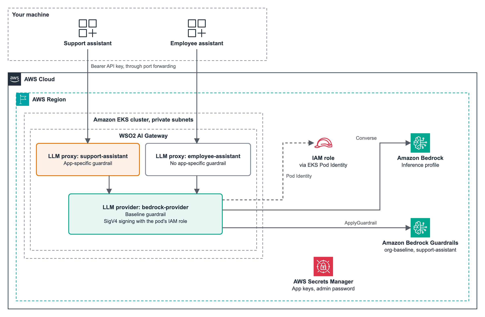

# Safeguard LLM traffic with Amazon Bedrock Guardrails and WSO2 AI Gateway on Amazon EKS

Code-only sample for running WSO2 AI Gateway on Amazon EKS with Amazon Bedrock Guardrails. It configures the gateway through its management API.

- **AWS side, as code:** Terraform creates two Amazon Bedrock guardrails, the VPC with an Amazon Bedrock Runtime VPC endpoint and flow logs, the EKS cluster, an Amazon RDS for PostgreSQL database, Amazon ECR repositories, a least-privilege IAM role for the gateway through EKS Pod Identity, CloudWatch log groups with a retention period, and an Amazon CloudWatch dashboard.
- **Gateway side, as code:** YAML files define the LLM provider, both App LLM proxies, and their guardrail policies. `deploy-artifacts.sh` deploys them through the gateway's management API.
- **No stored AWS keys:** the gateway pods get temporary credentials from EKS Pod Identity.



## Layout

| Path | Contents |
| --- | --- |
| `terraform/` | The guardrails, network, cluster, database, image repositories, IAM role, and dashboard |
| `helm/` | Helm values and the guardrail allowlist |
| `scripts/` | Prepare and install the gateway, port-forward, deploy the provider and proxies, test, and clean up |
| `gateway/` | Provider and proxy definitions, and the policy versions built into the gateway images |

## Prerequisites

- An AWS account and an AWS CLI session (AWS IAM Identity Center recommended).
- Docker, Terraform 1.9 or later, AWS CLI 2.9 or later, kubectl, Helm 3.12 or later, curl 7.76.0 or later, jq, envsubst, openssl, and unzip.

## Run

```bash
aws sso login
export AWS_REGION=us-east-1 BEDROCK_MODEL_ID=us.amazon.nova-2-lite-v1:0
MY_IP="$(curl -s https://checkip.amazonaws.com)/32"
TF_VARS=(-var="region=${AWS_REGION}" -var="model_id=${BEDROCK_MODEL_ID}" -var="eks_public_access_cidrs=[\"${MY_IP}\"]")

terraform -chdir=terraform init
terraform -chdir=terraform apply "${TF_VARS[@]}"

./scripts/prepare-gateway.sh       # builds the gateway images for linux/amd64 and pushes them to Amazon ECR
./scripts/install-gateway.sh       # installs cert-manager, creates the database tables, and installs the gateway

# In a second terminal, and keep it running:
./scripts/port-forward.sh

./scripts/deploy-artifacts.sh      # provider, both proxies, and one key per app in Secrets Manager
./scripts/test-guardrails.sh       # calls https://localhost:8443/<proxy>
terraform -chdir=terraform output -raw dashboard_url
```

`install-gateway.sh` generates the management API admin password and keeps it in Secrets Manager. It also generates the key that encrypts the gateway's secrets at rest, and keeps it in a Kubernetes Secret. Rerun it to apply changes. `deploy-artifacts.sh` deploys `gateway/bedrock-provider.yaml` and the two proxy files, fills in the Terraform outputs, and stores each application's key in Secrets Manager without printing it.

## What the guardrails check

Each guardrail policy reads one text value from the message body, at its `jsonPath`. The sample checks the first content block of the last message (`$.messages[-1].content[0].text`) and of the model's reply (`$.output.message.content[0].text`), and that block must be text. The policy can't select several values at once, so the guardrails don't check:

- The system prompt.
- Earlier messages in a multi-turn conversation.
- Other content blocks in the last message or in the reply.

If your clients send a system prompt, multi-turn history, or several content blocks, also apply the guardrails in the application, or call the Amazon Bedrock `ApplyGuardrail` API on the full conversation.

## Cost

The sample runs resources that charge by the hour. At on-demand prices in us-east-1, they cost roughly $0.60 an hour, or about $14 a day, before Amazon Bedrock usage:

| Resource | Approximate cost |
| --- | --- |
| EKS cluster | $0.10 an hour |
| Two m5.xlarge nodes | $0.38 an hour |
| NAT gateway and its public IPv4 address | $0.05 an hour, plus data processing |
| db.t4g.small database and 20 GB of storage | $0.04 an hour |
| Amazon Bedrock Runtime VPC endpoint in two Availability Zones | $0.02 an hour, plus data processing |
| KMS key, Secrets Manager secrets, CloudWatch logs and dashboard | A few dollars a month |

Amazon Bedrock charges for model and guardrail usage. Check current prices with the [AWS Pricing Calculator](https://calculator.aws/), and clean up when you finish.

## Security

- **No stored AWS keys.** The gateway pods get temporary credentials from EKS Pod Identity. The role trusts only the EKS Pod Identity service in your account, the Pod Identity association limits it to the gateway's service account, and it allows one inference profile, its model in each Region the profile routes to, and two guardrails.
- **Private network.** The nodes and the database run in private subnets. The gateway's services have no load balancer, and you reach them through `kubectl port-forward`. Calls to Amazon Bedrock go through a VPC endpoint. VPC flow logs record the traffic.
- **Encryption.** Kubernetes Secrets, including the key that encrypts the gateway's secrets, are encrypted with an AWS KMS key. The database storage is encrypted, and the gateway connects to it over TLS. `test-guardrails.sh` verifies the gateway's certificate.
- **Secrets.** The application keys and the generated admin password are in Secrets Manager, and Amazon RDS manages the database password there. The scripts never print them.

Some settings are deliberate for a sample that you create and delete in one sitting. Change them for production:

| Setting | Why the sample uses it | For production |
| --- | --- | --- |
| Public Kubernetes API endpoint | `kubectl` and Helm run from your machine. The endpoint accepts only the IP ranges in `eks_public_access_cidrs`, which can't be `0.0.0.0/0`. | Use a private endpoint and reach it from inside the VPC. |
| Mutable image tags in Amazon ECR | The ap CLI tags images with the gateway version, so a rebuild reuses the tag. | Use immutable tags with a unique tag per build. |
| Database without deletion protection, with one day of backups, no IAM database authentication, and no Performance Insights | `terraform destroy` must remove the sample completely. | Turn on deletion protection, longer backup retention, Multi-AZ (`db_multi_az`), and Performance Insights. |
| Default encryption for Amazon ECR and CloudWatch Logs | Both encrypt data at rest with AWS owned keys. | Use customer managed AWS KMS keys if your policies require them. |
| Database password copied into a Kubernetes Secret | `install-gateway.sh` copies the password that Amazon RDS manages in Secrets Manager. Amazon RDS rotates it every seven days, so after a rotation, rerun `install-gateway.sh` and restart the controller with `kubectl -n wso2-ai-gateway rollout restart deployment/wso2-ai-gateway-controller`. | Sync the secret into the cluster with the AWS Secrets and Configuration Provider (ASCP), so the controller always reads the current password. |
| Gateway connects as the database's master user | Amazon RDS creates and manages one user, so the sample needs no extra setup. | Create a dedicated user that can access only the gateway's database. |
| Database TLS with `sslmode=require` | The connection is encrypted without adding the Amazon RDS certificate bundle to the cluster. `require` doesn't verify the server's certificate. | Use `sslmode=verify-full` with the Amazon RDS certificate bundle. |
| One NAT gateway | It keeps the cost down. Outbound traffic, including the EKS Pod Identity credential calls, depends on one Availability Zone. | Use one NAT gateway in each Availability Zone, and route each private subnet through the NAT gateway in its own zone. |
| Self-signed gateway certificate | The chart's cert-manager Issuer signs it for `localhost`, for the port forward. | Use a certificate from your CA, and expose the gateway through an internal load balancer. |

## Clean up

```bash
./scripts/cleanup.sh
terraform -chdir=terraform destroy "${TF_VARS[@]}"
```

## Scan results

| Tool | Scope | Result |
| --- | --- | --- |
| Trivy (misconfiguration) | `terraform/` | No findings except the deliberate settings listed under Security |
| Trivy (secrets) | Whole sample | No findings |
| ShellCheck | `scripts/*.sh`, `helm/*.sh` | No findings |
