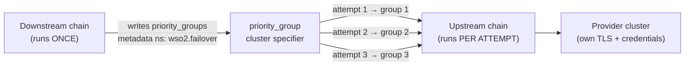
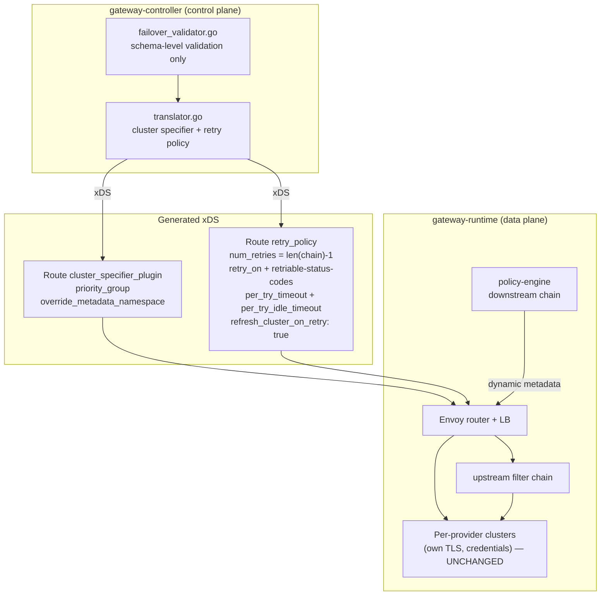
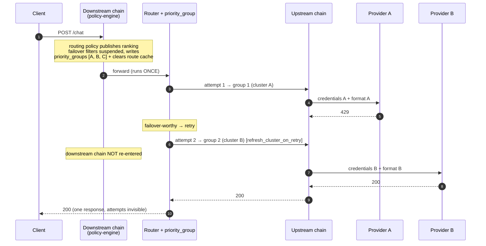
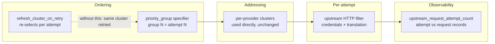
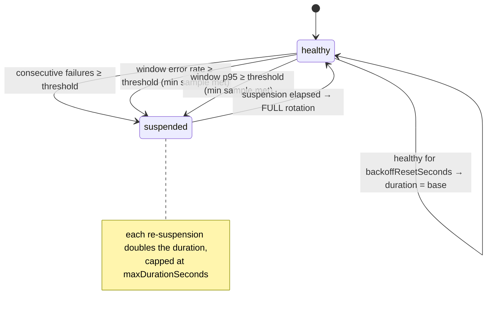

# Architecture: Model Failover Policy

**Feature**: 001-model-failover-policy | **Date**: 2026-10-23

How the adopted Envoy extensions fit together. Decisions and rejected alternatives are in
[research.md](./research.md); generated configuration is specified in
[contracts/generated-envoy-config.md](./contracts/generated-envoy-config.md).

---

## 1. The one idea

**Ordering is request data, not configuration.** The downstream policy chain runs **once** and writes
a ranked list of priority groups — each naming **clusters** — into request metadata. Envoy's
`priority_group` cluster specifier selects the group by attempt number. The downstream chain is never
re-entered; only the upstream filter chain re-runs, which is where per-provider credentials and
request translation are applied.

## 2. Control plane → data plane

What `gateway-controller` generates, and what consumes it at runtime.

## 3. Request flow — success, then failover

The distinction the whole design rests on: **retries re-invoke only the upstream chain.**

## 4. Which extension does what

| Extension | Role | Requirement served |
|---|---|---|
| `cluster_specifier_plugin.priority_group` | Selects the priority group by attempt number; stays on the last group when attempts overrun, so an excluded target is never reached | FR-021, FR-008, FR-025 |
| `RetryPolicy.refresh_cluster_on_retry` | Re-selects the cluster on every attempt. **Mandatory** — without it Envoy retries the same failing provider and failover silently does nothing | FR-008 |
| Route cache cleared after the metadata write | Makes the **first** attempt honour the per-request order | FR-021 |
| Upstream HTTP filter position | The only chain re-invoked per attempt — credentials, translation | FR-012e |
| Route `retry_policy` | Attempt budget, failover conditions, `per_try_timeout` + `per_try_idle_timeout` | FR-003, FR-005, FR-010, FR-027 |
| `upstream_request_attempt_count` | Separates attempt-level records from one per client request | SC-011 |
| Per-provider clusters, untouched | Each keeps its own TLS, credentials and health handling | FR-030c |

## 5. Target health

Health lives in the policy, per instance, behind a replaceable boundary (FR-020a). Suspended targets
are simply omitted from the list the policy writes — Envoy never sees them. There is no probe phase:
when a suspension expires the target returns to full rotation, and a further failure doubles the next
suspension up to a ceiling. That is what keeps recovery out of the ranking entirely.

## 6. Skipping a suspended target

A suspended target is omitted from the priority groups the policy publishes, so Envoy never sees it
for that request. Because groups name clusters, each selected cluster then applies its **own normal
health handling** — outlier detection, health checks — underneath.

This is a genuine improvement over the rejected Override Host design, whose host lookup carried an
upstream TODO (*"Validate that host health status did not change"*) and would select an unhealthy
host that appeared in the list.

## 6b. A surplus attempt budget produces no surplus attempts

When the attempt budget exceeds the number of published groups, the surplus attempts are **not
made**. Each group is dialled once and the request ends; nothing reaches for an unranked target.

**Corrected 2026-11-05.** This section previously said the surplus attempt *repeats the last group*,
on the strength of spike probe B4. Measured end to end against the gateway — a budget of four over a
published chain of two — the request made exactly two attempts, one per group, and returned the
exhaustion error (`failover-core.feature`, *A chain shorter than the attempt budget ends at its last
target*). The chain, not the budget, bounds the attempt sequence. The spike result stands for the
static Envoy configuration it was run against; this is what the generated configuration does.

The decisive comparison is unchanged and now rests on stronger ground. Under Override Host, probe A3
showed an excluded provider — the stand-in for a *suspended* one — receiving live traffic and serving
the request when `num_retries` exceeded the list length. `priority_group` does not dial it at all.
Matching `num_retries` to the chain length is still correct, but it is no longer the only thing
standing between a suspended target and live traffic.

## 6c. Two retry settings that must NOT be configured

- **`rate_limited_retry_back_off`** parses `Retry-After` / `X-RateLimit-Reset` and waits that long,
  up to a 300-second default ceiling. LLM providers send `Retry-After` on 429. Honoring the primary's
  rate-limit window before attempting a *different* provider is exactly backwards. Keep
  `retry_back_off.base_interval` small instead, and keep a test asserting the absence.
- **`hedge_on_per_try_timeout`** issues a second attempt without cancelling the first, returning
  whichever completes first. For LLM traffic that is a second billed inference call, with both
  possibly completing — contradicting one-request-one-cost (SC-011) and serving-target attribution
  (FR-016).

## 7. What is deliberately absent

- **No internal redirects.** The downstream chain is not re-entered; rejected by directive.
- **No per-ordering clusters.** One cluster per operation regardless of target count or ranking.
- **No custom Envoy build.** Every extension is present in Envoy 1.35.0+ (data plane runs 1.39.0)
  and in the pinned `go-control-plane/envoy v1.37.0`.
